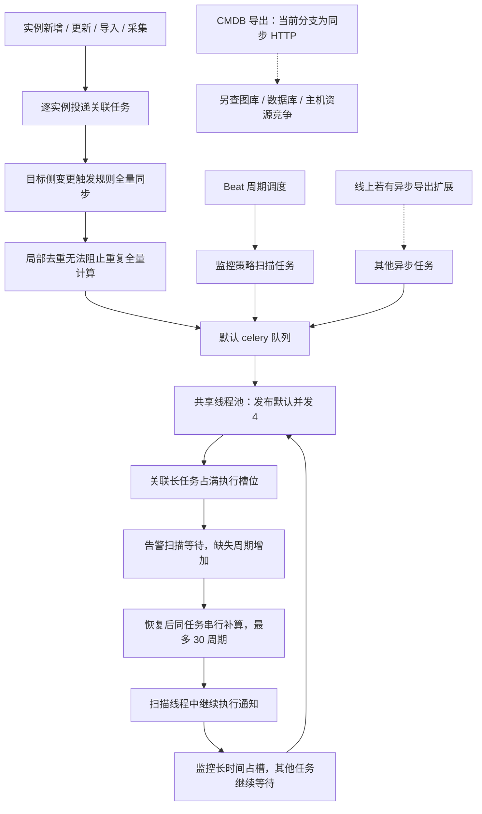
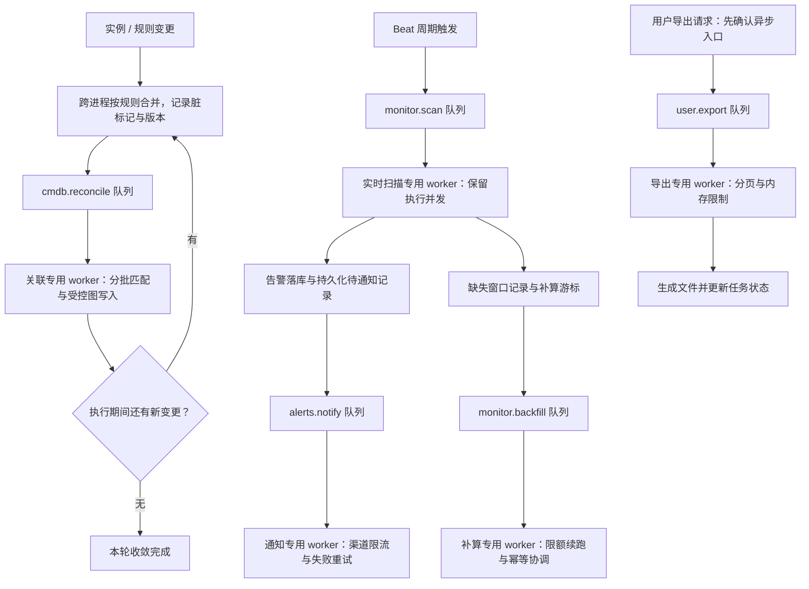

# CMDB 与监控中心异步任务相互阻塞分析报告

> 当前实施设计以 [统一弹性架构计划](../openspec/changes/isolate-celery-workload-runtime/design.md) 与 [实施任务](../openspec/changes/isolate-celery-workload-runtime/tasks.md) 为准：四类独立执行池、可配置 MIN/MAX、所有 MAX 的总预算约束，仅改运行架构。本文保留前期调查与方案比较；其中旧拓扑、固定并发和业务优化建议不构成本次实施要求。

> 历史方案说明：针对整机 16–32GB 曾在[全量任务与资源隔离报告](celery-task-inventory-and-resource-isolation.md)比较三个固定线程池方案；后续已按用户确认改为四池统一弹性配置。实际实施与内存预算以上述 OpenSpec 设计为准。

- 分析日期：2026-10-29
- 代码基线：`dd39ab8c23dcbf29b0548e2a9347bb24c9880fe3`
- 分析范围：Celery 配置与发布编排、CMDB 自动关联、监控策略扫描与补偿、CMDB 导出。
- 分析方式：静态代码与本机依赖源码核查；未连接生产环境，未执行负载实验，未修改应用代码。
- 结论边界：本文区分代码已确认事实、架构推断与现场待验证项，不能替代本次生产故障的运行证据。

## 1. 结论

**仓库默认部署中，不同业务的后台任务共用 Celery 默认队列和线程执行池，缺少执行资源隔离。CMDB 自动关联存在任务放大和重复全量计算，监控扫描延迟后又会串行补算，因此具备双向阻塞的完整条件。**

用户反馈的两个现象，与这一架构缺口高度一致：

1. CMDB 自动关联并发后，监控周期告警任务不执行。
2. 监控任务繁忙时，CMDB 异步导出无法及时执行。

第一项可从当前代码建立明确的候选因果链；第二项存在版本差异：**当前分支的实例导出是同步 HTTP 导出，尚未找到对应异步导出任务。** 线上若有异步扩展，需核对其任务名、路由和消费者；若使用当前同步实现，应检查共享数据库、图库及主机资源竞争。

建议将问题纳入后台任务执行架构治理，优先实施“专用队列 + 专用 worker + 任务合并与限额”，同时治理自动关联的计算放大和监控的补算行为。

## 2. 当前执行架构

```text
周期调度 Beat ───────────────┐
API/采集触发 CMDB 自动关联 ──┤
其他业务异步任务 ────────────┤
                            ▼
                    默认 celery 队列
                            │
                            ▼
                  单个 worker 线程执行池
                    发布默认并发为 4
                            │
              ┌─────────────┼─────────────┐
              ▼             ▼             ▼
           关系数据库      FalkorDB      VM/通知等外部依赖
```

这里的“单个”指发布模板中每个服务实例定义一个 worker。线上实际副本数、环境覆盖和自定义编排需现场确认。多个相同 worker 消费同一队列，只会扩大共享池，并不自动形成业务资源隔离。

| 已确认事实 | 代码证据 | 影响 |
|---|---|---|
| 发布模板定义一个 Celery worker，使用 `--pool threads`，未指定 `-Q` | `server/support-files/release/supervisor/celery.conf:1–5` | 所有默认路由任务共享线程槽位 |
| 发布脚本默认 `CELERY_CONCURRENCY=4` | `server/support-files/release/startup.sh:35–43` | 默认同时实际执行的任务数受四个线程限制 |
| Django 配置中并发为 2，但发布命令显式传入并发参数 | `server/config/components/celery.py:22`；上述启动配置 | 排障不能只看 Django 配置中的数字 |
| 未配置业务队列、任务路由、业务并发保留 | `server/config/components/celery.py`；`server/apps/core/celery.py:12–14` | 监控与 CMDB 没有执行资源边界 |
| Beat 与 worker 为独立进程 | `server/support-files/release/supervisor/beat.conf` | worker 忙不等于 Beat 停止调度 |
| worker 配置已留下长短任务隔离 TODO | `server/support-files/release/supervisor/celery.conf:2–4` | 该隔离缺口已被记录，但尚未落实 |

## 3. CMDB 自动关联：任务数量和单次耗时同时放大

### 3.1 任务产生链路

```text
新增、更新、导入或采集实例
  → 每个实例分别投递关联收敛任务
  → 对源侧规则进行关联计算
  → 若实例位于规则目标侧，再投递规则全量同步
  → 加载源、目标模型实例，逐源实例执行匹配和边更新
```

证据：

- 单实例创建、更新及批量路径会调用关联调度：`server/apps/cmdb/services/instance.py:594–596、684–686、777–779、1231–1233`。
- 采集写入后也会调度关联：`server/apps/cmdb/collection/common.py:113–115、146–148`。
- 调度器逐实例发送任务：`server/apps/cmdb/services/auto_relation_reconcile.py:27–50`。
- 目标侧实例变更退化为规则级全量收敛：同文件 `417–421`。
- 两个关联任务均为普通 `@shared_task`：`server/apps/cmdb/tasks/celery_tasks.py:325–338`。

### 3.2 当前去重无法覆盖排队和执行

`_PENDING_RULE_FULL_SYNC_IDS` 是模块内的 Python 集合。调度时加入规则 ID，投递完成即在 `finally` 中清除。

因此，它只能抑制局部时间窗口内的部分重复调度，无法提供以下保证：

- 多进程、多副本之间对同一规则去重。
- 队列中已有同一规则任务时不重复投递。
- 同一规则正在执行时不重复启动。
- 合并执行期间的新变更，并保证完成后再收敛一次。

证据：`server/apps/cmdb/services/auto_relation_reconcile.py:24、53–78`。

例如，同一目标模型的一批实例更新后，各实例任务都可能投递同一规则的全量同步。具体重复倍数取决于数据和时序，不能仅凭静态代码给出线上数量。

### 3.3 全量同步的成本较高

全量同步先读取目标和源模型实例，然后逐源实例执行关联收敛；匹配函数内部遍历规则、目标实例和字段匹配对。

近似匹配复杂度为：

```text
O(S × T × R × P)

S：源实例数
T：目标实例数
R：启用的规则数
P：每条规则的匹配字段对数
```

这还没有计入查询已有边、逐边删除、新增前约束检查和逐边创建的存储开销。对于规模接近的源、目标模型，匹配部分呈近似平方增长。

证据：

- 全量数据加载和源实例循环：`server/apps/cmdb/services/auto_relation_reconcile.py:425–466`。
- 目标匹配循环：同文件 `190–220`。
- 已有边查询与边增删：同文件 `293–378`。

**架构推断：关联任务的高频扇出、重复全量重算和较长执行时间叠加，会持续消耗共享线程池，并增加图库压力。**

## 4. 监控扫描：排队、补算和同步通知叠加

### 4.1 周期任务没有独立执行资源

策略周期任务仅设置任务名、参数、周期与启用状态，未指定专用队列或任务过期策略。

证据：`server/apps/monitor/views/monitor_policy.py:384–399`。

因此，现场看到“周期任务不跑”时，首先应区分：

| 状态 | 含义 | 关键证据 |
|---|---|---|
| 未调度 | Beat 没有产生本轮任务 | Beat 日志、周期任务启用和时间配置 |
| 等待执行 | 任务已投递或被 worker 接收，但未取得执行线程 | 队列、worker 任务状态、开始日志 |
| 执行缓慢 | 已开始，但查询、计算、通知等阶段耗时过长 | 阶段耗时、依赖响应、线程栈 |
| 去重或遗留锁抑制投递 | 同策略已有锁，后续触发复用已有任务 | 锁关联任务状态与实际存活情况 |

不能仅以周期任务的调度时间判断它已实际执行。

### 4.2 延迟恢复后会在同一任务中串行补算

扫描任务依据 `last_run_time` 计算缺失周期，并在同一函数中逐周期执行。单任务最多补算 30 个周期，时间差计算上限为 24 小时。

证据：

- `server/apps/monitor/tasks/monitor_policy.py:52–78`。
- `server/apps/monitor/constants/alert_policy.py:4–8`。

这里的“最多 30 个周期”是次数边界，不是执行时长边界。历史窗口查询慢或通知多时，单个任务仍可能长期占用线程。

```text
CMDB 关联占用线程
  → 监控扫描延迟
  → 缺失周期增加
  → 恢复后串行补算，扫描任务变长
  → 监控继续占用共享线程
  → CMDB 及其他后台任务等待
```

该链路解释了为什么阻塞可能由 CMDB 发起，随后表现为监控任务反向占用资源。

### 4.3 通知没有脱离扫描线程

事件告警创建后的通知通过 `transaction.on_commit` 调用通知服务。该机制保证提交后执行，但本身不会启动独立异步任务，因此通知仍占用当前执行线程。

证据：

- `server/apps/monitor/tasks/services/policy_scan/event_alert_manager.py:156–166`。
- `server/apps/monitor/services/alert_lifecycle_notify.py:59–62、260–263、282–294`。

指标查询已有连接和读取超时配置 `(3, 15)`，不能将其描述为完全没有超时；但单次请求超时也不等于整个扫描任务具有总耗时上限。

证据：`server/apps/monitor/utils/victoriametrics_api.py:14–24`；`server/apps/monitor/constants/victoriametrics.py:6`。

### 4.4 Singleton 存在异常恢复待验证项

扫描和生命周期补偿任务使用 `Singleton`。核对本机 `celery-singleton` 依赖源码可见：投递前加锁，重复投递返回已有任务结果引用，正常成功或失败时释放锁；锁有效期可配置。

仓库未发现 `singleton_lock_expiry`、任务级 `lock_expiry` 或锁恢复处理。因此存在 worker 异常退出后遗留锁、后续周期无法重新入队的风险。

这属于候选故障机制，尚未证实本次线上发生。普通排队也会持有锁，不能将所有现存锁都视为脏锁，更不能直接清空锁。

项目证据：`server/apps/monitor/tasks/monitor_policy.py:23、99`；依赖版本：`server/pyproject.toml`。

## 5. CMDB 导出：需要先核对线上实现

当前分支的实例导出路径为：

```text
HTTP 请求
  → InstanceManage.inst_export
  → 查询模型、属性、关联和图库实例
  → 生成 Excel
  → HTTP 返回文件
```

证据：

- `server/apps/cmdb/views/instance.py:761–783`。
- `server/apps/cmdb/services/instance.py:1348–1391`。

当前没有证据证明这个同步导出入口在等待 Celery 槽位。

| 线上实现 | 应验证的阻塞机制 |
|---|---|
| 另有异步导出任务，且消费默认队列 | 与监控共用 worker 的执行槽位 |
| 异步导出已有独立 worker | 图库、数据库、CPU、内存或连接资源竞争 |
| 与当前同步实现一致 | Web 请求处理、图库查询及主机资源竞争 |

TODO：核对线上版本、导出任务名称及路由。确认位置：线上镜像对应源码的 `inst_export`、`export`、`shared_task`、`send_task`，以及 worker 的 `active_queues`。

## 6. 架构问题归纳

| 问题 | 直接后果 | 优先级 |
|---|---|---|
| 实时检测与批量后台任务共用执行池 | 告警检测缺少执行资源保障 | P0 |
| 自动关联逐实例扇出并退化为全量同步 | 重复计算、队列和图库负载放大 | P0 |
| 监控补算与实时扫描使用同一执行路径 | 故障恢复时容易继续拥堵 | P1 |
| 通知在扫描线程中执行 | 外部渠道耗时拖长检测任务 | P1 |
| 缺少覆盖任务生命周期的去重与恢复机制 | 重复执行或异常后持续不调度 | P1 |
| 排队耗时与执行耗时缺少明确区分 | 运维难以识别“不跑”的具体阶段 | P1 |

P0/P1 表示本文建议的治理先后顺序，不代表已完成生产事故定级。

此外，`CELERY_MAX_TASKS_PER_CHILD = 5` 与当前线程池的执行模型不匹配，不能依赖它实现“每执行五次任务回收子进程”。线程池也不能作为 CPU 密集匹配计算的充分隔离手段。

## 7. 建议的执行边界

建议保留现有 Celery 体系，按业务时效与资源特征建立专用执行通道。以下名称是设计建议，尚未实现。

| 队列 | 任务范围 | 执行保障 |
|---|---|---|
| `monitor.scan` | 实时策略扫描 | 独立 worker 和保留并发 |
| `monitor.backfill` | 历史窗口补算 | 限额、分批、可续跑，不挤占实时扫描 |
| `alerts.notify` | 渠道通知及失败补偿 | 独立重试与渠道并发边界 |
| `cmdb.reconcile` | 自动关联及规则收敛 | 合并重复规则，限制图写入并发 |
| `user.export` | 已确认存在的异步导出 | 独立执行机会、内存与任务大小限制 |
| `background` | 其他普通后台任务 | 保留默认任务承接能力；重任务继续细分 |

**独立队列必须配合独立 worker 执行池。** 一个 worker 同时消费上述所有队列仍会共享并发，无法提供业务资源保障。初期可以在同一容器或主机中启动多个专用 worker，但仍需计算总 CPU、内存和连接预算；负载需要时再拆成独立部署。

具体并发值应通过任务耗时、触发频率和存储容量测量确定。不能直接将当前每类任务都设为四并发，以免把拥堵转移至数据库或图库。

### 7.1 自动关联的收敛设计

1. 以规则 ID 为主要合并键，使用跨进程状态记录排队、执行和待重跑信息。
2. 执行期间再次收到变更时记录脏标记或版本水位；完成后若仍有变更，再执行一轮，避免单纯丢弃重复请求造成漏收敛。
3. 明确规则级全量任务和实例级增量任务的协调关系，防止同时修改同一关联范围。
4. 全量同步按源实例分批执行，记录游标和规则版本；规则中途变化时有明确的重算策略。
5. 精确匹配采用合适的索引或候选集检索；包含匹配等复杂规则保留语义并限制扫描范围。
6. 涉及 `1:1`、`1:n` 映射时，分片必须保持跨批次的目标占用约束，不能直接把当前内存中的 `target_claims` 分散到互不协调的任务。

### 7.2 监控扫描与补算设计

1. 实时扫描、历史补算和通知分别调度，明确历史补算和实时扫描对告警状态的写入顺序及幂等要求。
2. 为补算设置每次时间或批量预算，持久化进度并可续跑。
3. 如需丢弃过期扫描消息，必须由持久化水位触发补偿，防止静默丢失检测窗口。
4. 对 Singleton 设计租约、续租、任务存活核验及受控恢复。简单设置很短的 TTL 可能导致旧任务未结束、新任务又启动。
5. 通知独立任务需保证告警落库与通知投递之间可恢复，使用持久化待通知记录或事务发件箱等机制，避免拆分后出现提交成功但消息未投递的空隙。

### 7.3 配置与发布必须一起治理

- 显式维护任务路由和专用 worker 的消费队列，覆盖 `send_task`、`.delay()` 和周期任务路径。
- 校验数据库已有 `PeriodicTask.queue` 等字段，防止历史显式队列覆盖新路由。
- 当前 `setup_periodic_tasks` 仅同步任务、周期、参数和启用状态，未同步 `options` 中的路由等字段。若未来通过 `CELERY_BEAT_SCHEDULE.options` 管理此类字段，应补齐同步逻辑；全局任务路由也可承担路由职责。
- 默认队列保留可识别的消费者，避免遗漏任务长期无人消费。
- 对长任务评估较低的预取设置，但预取优化不能代替执行池隔离。
- 验证任务采用的执行池与超时、取消、内存治理手段是否匹配。

周期配置同步证据：`server/apps/core/celery.py:34–74`。

## 8. 分阶段实施建议

| 阶段 | 主要工作 | 验收重点 |
|---|---|---|
| 第一阶段：隔离 | 监控扫描与 CMDB 关联分队列、分 worker；核对异步导出真实入口 | 单业务饱和时另一业务仍能开始执行 |
| 第二阶段：减负 | 关联规则去重合并、全量分批、匹配优化 | 变更风暴不会产生等比例重复全量计算，结果最终收敛 |
| 第三阶段：恢复 | 拆分补算和通知，完善租约与投递恢复 | 异常重启后继续推进，无重复告警副作用 |
| 第四阶段：运行治理 | 建立排队、执行、依赖耗时及容量指标 | 能准确定位延迟发生在何处 |

不建议以单纯调高总并发、提高消息优先级、增加队列名称作为最终修复。它们无法抢占已经运行的长任务，也无法减少重复全量计算。

## 9. 现场排查步骤

以下步骤以读取状态为主，应在与生产服务相同的应用环境执行。部署命令、实例范围和输出留存方式按现场实际调整。

### 9.1 核对实际部署与消费者

记录镜像版本、服务副本数、worker 启动参数、实际并发、消费队列、Beat 实例及其日志。确认是否与本文分析的默认模板一致。

```bash
celery -A apps.core.celery inspect active_queues
celery -A apps.core.celery inspect stats
celery -A apps.core.celery inspect active
celery -A apps.core.celery inspect reserved
```

不要仅凭 `reserved` 为空排除等待执行。当前使用线程池，需结合实际开始日志、worker 活动状态和线程池内等待情况判断。

### 9.2 将消息积压与执行日志对齐

- 在消息代理侧查看目标队列的 ready、unacked、消费者数量及变化趋势。
- 在 Beat 日志查同一策略是否持续触发投递。
- 在 worker 日志查任务接收、业务开始及结束时间。
- 统计关联任务、全量同步任务、监控扫描任务的数量和持续时间。
- 对同一规则统计是否短时间重复执行全量同步。

### 9.3 核对周期任务与锁

通过 Django ORM 检查对应 `PeriodicTask` 的启用、周期、`queue`、`last_run_at`、`total_run_count`，并对照 `MonitorPolicy.last_run_time`。

当 worker 已空闲，但同一策略仍不再进入执行时，检查 Singleton 锁关联的任务 ID、锁有效期及任务实际状态。**结果后端中无记录或显示 `PENDING`，本身不能证明任务不存在。**

只有核实任务已不在队列、不在任何 worker 执行，且不会因重投产生并发副作用后，才考虑定向恢复；不要全局清锁或清空消息队列。

### 9.4 核对底层资源竞争

若任务已经开始却长时间不结束，继续观察：

- CPU、内存、容器限额和进程/线程状态。
- 关系数据库连接、锁等待和查询耗时。
- FalkorDB 查询、写入耗时及连接状态。
- VictoriaMetrics 响应时间、超时和查询规模。
- 通知渠道及跨服务调用耗时。

若导出是同步 HTTP 路径，增加 Web 请求耗时和图库查询链路的关联分析。

## 10. 改造验收场景

后续实施应先编写行为测试，再完成代码修改；按仓库规则执行后端门禁，并在隔离测试环境进行并发验证。

| 场景 | 必须验证的行为 |
|---|---|
| CMDB 关联 worker 满负荷 | 监控实时扫描在约定的排队时延目标内开始 |
| 监控扫描或补算持续繁忙 | 已确认的异步导出仍获得执行机会 |
| 同规则短时间多次实例变更 | 合并重复计算，最后一次变更也能收敛 |
| 同规则运行时又收到变更 | 完成后按需再跑，不能漏更新或无界重跑 |
| worker 在关联或扫描途中退出 | 恢复后可继续推进，无永久锁阻断 |
| 通知渠道慢或失败 | 不占满实时扫描执行池，可恢复投递 |
| 全量关联分批或多 worker 执行 | 保持映射约束和边更新正确性 |
| 新旧路由切换 | 所有目标队列有消费者，存量任务可有序处理 |

具体时延、吞吐和资源目标需在取得线上任务规模与耗时分布后确定，不在缺乏数据时给出固定并发或时延承诺。

## 11. 尚待确认的信息

1. 生产实际运行版本、worker 数量、并发和消费队列。
2. “CMDB 异步导出”的真实任务入口及任务名。
3. 故障时 Beat 是否持续投递，任务卡在排队还是执行阶段。
4. 同一自动关联规则是否出现重复全量同步及其数据规模。
5. 监控是否处于大量历史补算或通知耗时阶段。
6. 是否存在 worker 异常退出后遗留的 Singleton 锁。
7. 图库、数据库或主机资源是否同时成为瓶颈。

这些信息决定本次事件的直接诱因与容量配置；已确认的共享执行池、关联放大及补算耦合问题，可以作为架构改造的依据。

## 12. 问题与优化流程图

以下图示整理于 2026-10-30。当前问题图描述代码具备的阻塞机制，线上实际触发链路仍需现场验证；优化图为建议方案。

### 12.1 当前问题：共享线程池与负载反馈



### 12.2 优化方案：执行隔离、变更合并、补算分流

图中每个“专用 worker”均代表独立执行池；不能由同一个共享 worker 消费所有队列。箭头描述业务数据流，具体事务投递、任务幂等和状态更新协调仍需在实施设计中落实。



资源隔离保证不同业务拥有执行机会，但底层数据库、图库、CPU 和内存仍需要统一容量预算。当前分支的同步导出不自动经过 `user.export`；接入该通道属于后续设计与实现。
