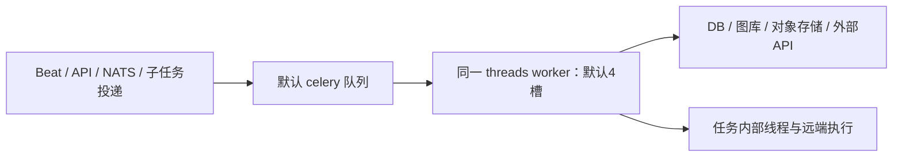

# Celery 全量任务清单与低内存资源隔离建议

> 历史调研归档：本文针对旧 `dd39ab8c23`，不代表最新上游部署。当前182项任务、原生prefork和既有专用消费者见[最新清单](celery-current-task-inventory.md)，实施以[当前设计](../openspec/changes/isolate-celery-workload-runtime/design.md)为准。

> 当前实施设计以 [统一弹性架构计划](../openspec/changes/isolate-celery-workload-runtime/design.md) 与 [实施任务](../openspec/changes/isolate-celery-workload-runtime/tasks.md) 为准：四类独立执行池、可配置 MIN/MAX、所有 MAX 的总预算约束，仅改运行架构。本文保留前期调查与方案比较；其中旧拓扑、固定并发和业务优化建议不构成本次实施要求。

- 分析日期：2026-10-30；基线提交见配套 JSON。
- 场景：整机通常为 **16–32GB，数据库、图库、消息代理、后端等所有组件同机部署**。
- 方法：静态检索任务装饰器、自动发现导入、静态/动态周期配置、异步投递与直接调用，阅读任务体及关键下游；对线程池语义核对本机 Celery 依赖源码。未连接生产、未启动 worker、未进行压测或 RSS 测量。
- 输出：[可检索任务清单 JSON](celery-task-inventory-and-resource-isolation.json)。本文只新增分析文档，不修改应用代码。

> 现场证据更新（2026-10-30）：用户提供的 Redis 队列截图显示基础键 `celery` 长度为 11,072，列表头部500条样本中节点状态收敛任务占94.2%，且出现本地基线没有的7个任务名。详见第11节。原 C2/I1/B1 仍是候选拓扑，**不能在未治理节点收敛投递风暴前，将这些任务原样全部归入检测C池并宣称完成隔离**。88项明细仍是本地基线清单，不代表截图所在线上版本的完整清单。

## 1. 结论与对原方案的修正

**应按时效和实际负载职责划分执行池，以模块作为任务归属和维护边界。不要按每模块、每队列各启动一个 worker。** 同一模块内的任务差异很大：监控包含检测与全量实例同步，CMDB 包含采集、关联和通知，OpsPilot 包含聊天、进度更新与知识库重建。按模块划分会保留模块内部阻塞，并复制过多 Python/Django 常驻内存。

[此前局部报告](celery-queue-contention-analysis.md)提出了扫描、补算、通知、关联、导出等专用 worker。它们适合作为**逻辑职责边界和后续扩展方向**，不应直接转化成 16GB 同机环境的常驻进程数量。本文对其部署建议作明确收敛：

1. **首选三个固定 threads worker：检测/控制 C、通知与有限短交互 I、重后台 B。** 初始并发候选为 `2 / 1 / 1`，总任务槽位仍为 4；这是验证起点，不是容量承诺，也不一定比当前部署更省内存。
2. **聊天、采集调试、远端脚本等“用户在等”的任务可能很长，不能因为实时性高就全塞入 I。** 16GB 保守档先限制并发放 B，接受可见的排队；有明确聊天时延要求且实测有余量时，启用第四个 A 池。作业与关联争用更严重时，第四池也可以优先给操作执行，按业务目标选择。
3. 仅路由现有任务，能够把 CMDB 关联、知识库重建与检测分开，**不能把现有检测任务变成短任务**。监控扫描仍带串行补算和同步通知，日志扫描也如此，告警聚合和分派仍有批量循环。需要后续拆分、分批与状态协调，才能进一步改善 C 池内部的延迟。
4. 独立池隔离的是任务槽位和部分进程内资源；数据库、图库、CPU、磁盘、消息代理仍共享。无界大任务可以耗尽整机内存。**有限内存、同机运行 AI 重任务、所有交互都有硬实时保证，三者不能同时默认成立。**

## 2. 当前部署及统计口径

### 2.1 当前执行拓扑

| 事实 | 证据 | 含义 |
|---|---|---|
| 发布 worker 为 threads，命令未带 `-Q`，默认并发4 | `server/support-files/release/supervisor/celery.conf:5`；`startup.sh:37` | 默认队列共享执行槽位 |
| 配置并发2被发布命令显式并发覆盖 | `server/config/components/celery.py:22` | 实际部署应以命令及 inspect 为准 |
| 无业务 `task_routes` / `task_queues`，`CELERY_IMPORTS=()` | `server/config/components/celery.py` | 目前未按职责分流 |
| Beat 独立进程，周期配置写入 django-celery-beat | `server/apps/core/celery.py:17`；`server/support-files/release/supervisor/beat.conf` | Beat 存活与 worker 有执行机会是不同问题 |
| Django app 自动发现任务 | `server/apps/core/celery.py:14`；`server/config/components/app.py:140` | `-Q` 只选择消费队列，不限制 Django/任务模块导入 |
| 同一发布脚本还默认启动 Web 8 worker、NATS 4进程 | `server/support-files/release/startup.sh` 及 supervisor 配置 | Celery 只是整机进程预算的一部分，不能只优化其并发数字 |



### 2.2 全量定义和活跃状态不是同一个数字

仓库检出 **88 个自定义装饰任务定义**：OpsPilot 25、CMDB 14、节点管理13、告警11、作业8、MLOps 7、监控4、系统管理3、日志2、core 1。未把 Celery 内建任务、第三方包任务、普通 helper、远端模型训练程序和同步 HTTP 导出混入此数。

| 统计项 | 数量 / 说明 |
|---|---|
| 高实时性 | 37；包括用户交互、告警和状态收敛的时效需求，不表示实现已经很快 |
| 高耗时风险 | 66；指全量遍历、批量处理、远端执行、LLM等待等可能长期占槽 |
| 高并发/扇出风险 | 40；指事件风暴、逐对象投递、重试或内层线程放大，非观测到的QPS |
| 高内存风险 | 41；指大列表/内容、匹配工作集、压缩/解压、并行目标及结果等；非测量值 |
| 建议执行类 | C 17、I 11、B 51、A候选5、U待核实4，共88 |

四个风险维度可重叠，不能相加得到任务总数。高/中/低为**静态风险和需求标签**：低不等于零风险，高也不表示当前线上已经慢。B 里的 A 候选单独标记，因此三池档实际承接 `C17 / I11 / B56` 个定义，U4不预设新增业务调度。任务类型数量不能用于分配并发，真正需要测的是到达率、耗时分布、工作集和业务期限。

### 2.3 注册和调用核查中的例外

- 大部分任务默认名为“定义模块路径 + 函数名”。本次88个装饰器未发现显式 `name=`。MLOps 有6个函数都叫 `publish_dataset_release_async`，**模块路径不同，是真实的6个任务名**，不能按短函数名去重。
- `tasks/__init__.py` 导入模块中的任一函数都会执行整个模块，因此 CMDB、monitor、log 包没有逐个列出全部函数，不代表同模块其余任务无法注册。
- `apps.core.tasks.auditlog_flush_task.clear_audit_logs`：core的 tasks 包未导入此文件，未发现生产导入、投递或静态周期；只找到测试引用。应先核对线上注册，不应直接认为每天运行。
- `sync_collect_credential_results_task` 仅日志并返回 skipped；当前凭据结果通过 NATS 推送。`uninstall_collector` 为 `pass`。两者都不能计为有效业务负载。
- `sync_shield` 有实现和包导出，但未找到生产投递调用。`update_graph_task` 只找到 `GraphUtils` 直接调用；它有任务装饰器，但当前该链路并不排队。
- 未分派告警周期配置写的是 `apps.alerts.tasks.sync_no_dispatch_alert_notice_task`，定义默认名却是 `apps.alerts.tasks.tasks.sync_no_dispatch_alert_notice_task`。包重新导出不自动创建任务名别名。证据：`server/apps/alerts/views/system_setting.py:112`、`server/apps/alerts/tasks/tasks.py:322`。这是静态任务名不一致，需以线上 registered 和 PeriodicTask 记录确认实际影响，不能在隔离改造中照抄错误名称。
- `.delay()`/`.apply_async()`/`send_task()` 才是这里的投递路径。直接 `task(...)` 不经过路由：例如 `sync_no_dispatch_alert_notice_task → sync_notify`、批量嵌入 → `invoke_document_to_es`、全局记忆刷新 → 单节点刷新、GraphUtils → `update_graph_task`。另有关闭Celery时同步执行的分支。
- 默认注册还取决于 `ENABLE_CELERY`、`INSTALL_APPS`、依赖能否成功导入和实际镜像。本文不是线上 `inspect registered` 的替代品。

## 3. 触发来源：18个静态周期条目与动态周期

以下为所有相关模块启用时的代码配置；数据库中历史配置、停用状态、显式 queue 和线上环境覆盖必须另外核对。时间使用项目 Celery 时区配置，不以注释推定。

| 模块 | 静态调度 |
|---|---|
| alerts（5） | 聚合每分钟；自动关闭每5分钟；提醒每分钟；提醒清理每小时；升级每分钟 |
| cmdb（4） | 采集状态收敛每5分钟；订阅检测每5分钟；数据清理每日02:00；IPAM对账每小时整点 |
| job_mgmt（1） | 分发文件清理每日00:00 |
| log（1） | 通知补偿每5分钟 |
| monitor（2） | 实例/分组同步每10分钟；生命周期通知补偿每5分钟 |
| node_mgmt（2） | 云区域健康每15分钟；节点版本发现每30分钟 |
| opspilot（2） | 工作流附件清理每日03:00；待刷新记忆每日00:00 |
| system_mgmt（1） | 密码到期通知每日00:00 |

依据为各模块 `config.py` 的 `CELERY_BEAT_SCHEDULE`。节点健康注释写每5分钟而配置为15分钟；密码提醒 docstring 写09:00而配置为00:00，本文以执行配置为准。

动态周期至少包括：监控策略、日志策略、CMDB采集、CMDB节点同步与采集、未分派告警通知、定时作业、网页知识同步、ChatFlow周期节点、登录模块用户组同步。来源分别为 `monitor/views/monitor_policy.py`、`log/views/policy.py`、`cmdb/services/collect_service.py`、`cmdb/services/node_mgmt_sync_service.py`、`alerts/views/system_setting.py`、`job_mgmt/services/scheduled_task_service.py`、`opspilot/models/knowledge_mgmt.py`、`opspilot/utils/celery_task_utils.py`、`system_mgmt/models/login_module.py`。

因此，18个静态条目远不等于线上周期任务数。若有 N 条监控策略、M 条日志策略、K 条采集配置，任务到达率取决于各条周期，而非“只有三个扫描函数”。`countdown` 还用于作业排队补投、取消收敛、安装超时、MLflow轮询及渠道失败重试；这些不是额外函数，却会带来积压和常驻延迟消息。

## 4. 影响隔离方案的关键调用链

### 4.1 检测并不都是短任务

- 监控 `scan_policy_task` 最多同任务串行补30个窗口，日志 `scan_log_policy_task` 最多10个窗口。次数上限不是总时间上限。监控通知经 `on_commit` 仍在当前线程，日志扫描内也发送通知。依据：`monitor/tasks/monitor_policy.py:24`、`log/tasks/policy.py:15`、两模块 `constants/alert_policy.py`、`monitor/tasks/services/policy_scan/event_alert_manager.py`、`monitor/services/alert_lifecycle_notify.py`。
- 告警聚合、即时批量构建、自动分派、提醒和升级有全量或批量循环。自动分派大列表会拆片再投递，后续通知通常异步，但不能据此断言整个检测阶段有固定耗时。依据：`alerts/tasks/tasks.py:150`、`alerts/aggregation/processor/aggregation_processor.py`、`alerts/service/reminder_service.py:295`、`alerts/service/escalation_service.py:225`。
- 所以 C 池的第一阶段含义是**保留检测/控制执行机会，挡住外部重后台负载**。尚不能保证核心控制任务不被同池检测长任务拖慢。状态收敛受阻仍可能延迟释放后续安装名额。

### 4.2 CMDB关联同时放大任务数量与单次成本

逐实例投递关联任务；目标侧变更可再投递规则级全量；模块内set在投递完成即清除，不覆盖排队、运行和多进程。全量匹配主要成本随源实例、目标实例、规则和字段对增长，近似 `O(S×T×R×P)`，另有逐边数据库/图库I/O。依据：`cmdb/services/auto_relation_reconcile.py:24、27、53、190、293、417、425`。

B池并发1只能限制同时执行的数量，不能消除重复全量计算或队列爆炸。需要按规则跨进程合并，并保留执行期间的变更水位/待重跑标志；分批时保持1:1、1:n映射约束。不能靠丢弃重复消息导致最终状态漏收敛。

### 4.3 作业和安装：线程并发不等于远端并发

`JOB_EXECUTION_MAX_WORKERS` 默认10，脚本与文件分发 runner 内部使用 `ThreadPoolExecutor`。一个Celery槽可同时占用多目标请求/输出工作集；B池2槽在这些路径上可能产生约20个目标操作，仍不含其他内部线程。依据：`job_mgmt/config.py:18`、`job_mgmt/services/script_execution_runner.py:97`、`file_distribution_runner.py:54`。

控制器安装已经区分主任务编排、逐节点bootstrap、回调收敛和超时。每安装主任务的bootstrap名额为3，但多个主任务的名额可累加；不要误称整个集群全局只有3个安装。依据：`node_mgmt/tasks/installer.py:336`、`node_mgmt/constants/installer.py:14`。应保留其状态机和尝试代次校验，将实际远端操作放B，将编排/收敛放C，避免操作执行堵住其完成信号。

远端操作不能通过粗暴终止worker“优化耗时”：worker停止不等于远端脚本停止；本地CANCELLED也可能表示远端结果未知。路由、限流和重试改造必须保留权限、危险命令校验、幂等、取消协议、结果补偿及恢复语义。

### 4.4 OpsPilot：交互时效高，并不代表工作负载轻

聊天工作流可能调用LLM、检索、工具及记忆处理。`_run_in_native_thread` 虽开一个内部线程，但调用 `future.result()` 等待，**没有释放Celery槽**。记忆缓存达到阈值后会同步刷新，不能因函数名有cache就视作纯短写入。依据：`opspilot/tasks.py:56、1378、1464、1497、1857`。

知识库重建、问答生成和图谱处理既可能耗CPU/内存，也会等待外部API。不能统一称为纯CPU或本地模型推理；当前任务名“retrain_all”实际是知识库文档重嵌入。AI聊天若与长后台任务同B池，必须承认排队延迟；若与告警通知同I池，可能拖慢通知。要保留二者执行机会，需第四池或减少同时启用的功能、错峰执行或使用独立外部算力。

### 4.5 MLOps：发布数据集与模型训练需区分

6个发布任务是数据下载、整理、统计、ZIP打包与上传，不是Celery进程内训练模型。`poll_train_job_status` 是远端MLflow状态轮询。文本/CSV通用发布已分块读取和计数，不能笼统声称六类都把文件一次读入内存；图片/目标检测路径存在整文件 `read()`、解压和目录重排，需要更严格的文件大小、解压膨胀、临时磁盘和并发预算。依据：`mlops/tasks/base.py:94、188`、`image_classification.py`、`object_detection.py`、`poll_train_job_status.py:23`。

发布任务配置了soft/hard time_limit，当前threads池不能据此假定会中止执行。应先给I/O和阶段设置真实截止/资源边界，再决定是否迁移到很小的prefork池。

## 5. 低内存部署分档

### 5.1 推荐逻辑职责与物理池

| 类 | 职责 | 三池档消费方式 | 明确保留的风险 |
|---|---|---|---|
| C | 告警检测、核心状态推进、安装/作业收敛 | 独立 threads worker，候选并发2 | 检测内的补算、批量处理、同步通知仍可能互堵 |
| I | 通知、回调、少量状态观察及短写入 | 独立 threads worker，候选并发1 | 批量通知和外部超时仍可能占槽；不是任意用户交互池 |
| B | 关联、采集、同步、清理、远端执行、知识处理、数据集发布 | 独立 threads worker，候选并发1 | B内业务互堵是刻意接受的内存/吞吐取舍 |
| A | 5个聊天/测试工作流候选 | 三池档归B；有余量可独立第4池 | 仍有LLM/工具等待与共享依赖竞争 |
| U | 无有效工作/未见生产投递的定义 | 不新增调度；先核对线上 | 不能凭清单删除已有消息或历史任务 |

初期可以只用 `core / io / background` 三条业务队列，加原 `celery` 过渡队列归B消费。若为观测、准入和后续迁移保留 `background.reconcile`、`background.ai`、`background.job` 等逻辑队列，可让**同一个B worker**消费；这不增加Python进程，但也不产生类别间并发保留或公平性保证。不要用“多个队列名称”代替资源隔离。

### 5.2 16GB保守档、32GB扩展档

| 档位 | 建议起点 | 适用条件与取舍 |
|---|---|---|
| 16GB整机：推荐验证档 | C2 / I1 / B1，3个threads进程，Beat保留1个；总4槽 | 先测全组件稳态和峰值。相比当前1进程新增2份基础应用常驻内存；后台单槽，限制导入/文件/模型规模与内层线程；AI重建错峰、避免与大量远端操作同时启动 |
| 16GB整机：内存紧张降级 | C2 / B1，2个threads进程，I和A暂归B | 优先保护检测免受后台影响；通知、用户交互可能在B排队，不能承诺告警送达时限。若通知时限不可退让，应减少功能/批次或迁移重负载，不能靠无限压低并发解决 |
| 32GB整机：基础档 | 仍从C2 / I1 / B1开始 | 内存翻倍不意味着数据库/图库和所有任务并发都翻倍；先看瓶颈与余量 |
| 32GB整机：按证据扩展 | 优先给最受影响职责第4池，候选A1；或B从1升2 | 只有最坏批次工作集、外部并发和底层容量验证通过才扩大；第四池可按需启停，不能同时默认开AI、作业、CPU等多个专池 |

这里的“16GB”不构成能部署全部组件和全部AI能力的承诺。若关系库/图库/搜索服务、向量数据、模型服务已经占满机器，必须削减同时运行的功能、缩小数据规模或外移重服务。只拆Celery无法制造内存。

同一容器中多个worker仍会共享容器内存上限：一个进程OOM可能影响整容器，Supervisor重启也不能提供资源硬隔离。先可在现有发布方式内做槽位隔离；有SLO要求时再用少量独立容器/cgroup设置CPU、内存、文件/进程限额，避免重池压垮核心池。共享DB、图库和磁盘仍需全局准入限制。

### 5.3 队列、进程与任务工作集分别如何占内存

| 成本项 | 成本在哪里 | 控制方式 |
|---|---|---|
| 空队列及消费者元数据 | Broker与连接少量固定结构；不是一份Django应用 | 逻辑队列可多于物理池，但不要无界创建 |
| 常驻worker基础RSS | 每个Python进程的解释器、Django app、导入依赖、客户端缓存 | 限制物理进程数；按实际应用组合测量，不承诺固定MB |
| prefork子进程 | 父进程+子进程；初始可共享部分页，写时复制及任务触达后增长 | 不将concurrency理解成只添线程；以PSS/容器内存测真实成本 |
| threads并发工作集 | 共享基础堆，但每任务大对象、线程栈、连接、输出、内部线程累加 | 限并发之外，还需文件/批次/目标/结果大小边界 |
| Broker消息积压 | 参数payload、ready/unacked消息的内存和持久化存储 | 参数以ID为主；限制入队速率/去重/批次，监控最老消息年龄与字节数 |
| Worker预取/ETA | 反序列化请求、线程池待执行项、countdown/ETA定时器 | 区分active/reserved/scheduled与真正业务开始时间；不要假设队列长度就是全部积压 |
| 结果与业务输出 | 可选result backend、数据库执行结果、缓存、对象存储 | 核查消费者再选择ignore_result/过期；大结果存对象存储，返回引用 |
| 临时文件/解压/文件页缓存 | 临时磁盘、OS页缓存及容器内存核算 | 限压缩前后大小与磁盘使用，结束清理，不能只看Python对象 |

建议按整机预算思考：

```text
可给Celery的余量 = 整机可用预算
                 - OS/运维与安全余量
                 - DB/图库/MQ/搜索/对象存储等峰值
                 - Web/NATS/Beat与其他服务峰值

Celery峰值 ≈ 各worker基础常驻之和
           + 同时运行任务及其内部线程的增量工作集
           + 预取/ETA/客户端缓存及运行余量
```

不能把单个空闲worker RSS乘3就当成完整预算，也不能将多进程RSS相加当成精确物理占用；评估PSS、USS和cgroup `memory.current`，同时观察整机可用内存、swap、OOM和磁盘压力。不要为了给Celery腾内存擅自把Web8/NATS4直接降到某个数字，应先测其负载和职责。

### 5.4 何时才考虑prefork

先优化关联重复计算、候选集与分批，保持B并发1。只有剖析证实纯Python CPU计算/GIL是主要瓶颈，或必须具备任务进程回收与可验证的强超时能力，才为这些任务考虑**按需启用、concurrency=1的很小prefork池**。它应替代部分重任务执行路径或作为资源允许的专门档位，不能在三池+AI第四池外再无条件叠加常驻进程。

CPU专池能减少同进程GIL竞争，但同机CPU、内存和图库仍共享。图片压缩、网络等待、原生扩展释放GIL的情况不同，不能把所有“耗时高”任务都迁到prefork。轻量导入需要独立settings/app依赖边界、延迟导入及注册测试；仅 `-Q cpu` 不会阻止当前 `opspilot/tasks.py` 顶层的LangChain、图谱、引擎等导入，也不能随便裁掉跨模块依赖的 `INSTALL_APPS`。

## 6. 现状路由与目标形态：分两步实现

### 第一步：原样任务分池，先建立最低隔离

- 按下文完整清单映射路由，A暂归B；保持原默认 `celery` 消费者归B，防止遗漏任务无人消费。
- 使用准确注册名；六个MLOps同名函数必须区分模块；覆盖send_task字符串、API异步、Beat动态配置和重试路径。
- 核查数据库 `PeriodicTask.queue/exchange/routing_key/priority`，显式设置可能改变预期路由。`setup_periodic_tasks` 当前只同步任务、时间、参数、enabled，未同步 `options` 中的队列等字段，不能仅修改 `CELERY_BEAT_SCHEDULE.options` 就认为数据库记录已迁移。
- 控制B入口速率、文件与批量大小、每租户/规则并发和内部目标线程。`worker_prefetch_multiplier=1` 可以作为实验起点，但线程池/ACK方式下不能当作“最多预取一个任务”或公平保证；必须测任务真正开始时间和worker内部等待。
- 保留所有业务状态机、重试与远端安全协议。不要全局改 `acks_late`、强制terminate或丢弃过期扫描来换取表面低延迟。

此阶段承诺应限定为：“CMDB/AI重任务饱和时，检测池仍有独立槽位”；不能承诺监控补算期间实时扫描不互堵，也不能承诺B池的导出/作业/聊天均及时。

### 第二步：拆分内部长阶段，减少池内互堵

| 链路 | 必须补齐的实现 | 不能省略的语义 |
|---|---|---|
| 监控/日志扫描 | 检测、有限补算、发送阶段分离；补算归B | 水位、事件顺序、告警生命周期幂等；过期触发仍要可补偿 |
| 通知与回调 | 分批、渠道并发、可恢复待发送记录、真实请求超时 | 落库与投递之间的恢复，重复投递去重；不得静默丢通知 |
| CMDB关联 | 跨进程按规则合并、分批、候选索引 | 执行中变更不漏，关系基数约束和并发写一致性 |
| 提醒/升级/聚合 | 每次有限工作量和续跑游标 | 不因截断批次丢提醒或重复建告警 |
| 重后台与AI | 准入、可恢复阶段、批次/内容/结果界限 | 工作流副作用、取消及重试可追溯 |

未来拆出的通知/补算函数属于新任务，**不在当前88个定义中**。当前CMDB实例导出是 `views/instance.py:761 → services/instance.py:1348` 的同步HTTP路径，不能杜撰现有 `export` 任务来加入路由；线上若存在异步扩展需补充其真实定义。

## 7. 超时、ACK、取消和遗留锁

- 本机Celery线程池实现是 `ThreadPoolExecutor.submit`；没有prefork式任务进程隔离。当前 `CELERY_MAX_TASKS_PER_CHILD=5` 不能让threads worker每5任务回收一个子进程；其配置键是否映射到当前版本的 `worker_max_tasks_per_child` 还应单独核查。不可把它作为内存治理保障。
- MLOps任务的soft/hard limit在当前threads池上不能视为可用的强停止机制。真实控制应依靠请求连接/读超时、整体截止、文件/输出上限、可中断阶段和远端取消协议。线程池正在运行的任意业务不能安全地靠一个Celery配置强杀。
- 作业任务显式 `max_retries=0`，不能为“保证完成”统一加自动重试；远端副作用可能已发生。MLOps配置late ACK与worker丢失重投，也需要核验发布状态、临时文件与重复执行的恢复语义，不是exactly-once保证。
- 当前监控与日志扫描/补偿使用Singleton，聚合/订阅另有缓存锁。这些锁可以抑制重复，但不保留线程名额。异常退出、锁过期与长任务并发的恢复需要存活核验和租约设计；不能无脑全局清锁或简单缩短TTL。
- CMDB订阅通知使用全局发送锁，竞争时直接返回；增加I池并发不能自动提高吞吐，甚至可能放大批次被跳过的问题。需核查事件是否有持久化补偿后再设计分批/并发。依据：`cmdb/services/subscription_task.py:90`。
- `.retry(countdown=...)` 形成新的调度请求，不是线程里sleep，但大量ETA仍可能占worker请求/定时器内存；是否使用broker原生延迟、配置版本和消息语义需要现场核实。

## 8. 全量88个任务明细

表中风险顺序为“实时需求 / 耗时风险 / 并发风险 / 内存风险”。**C/I/B表示建议池，A为可选独立AI交互类（三池档落B），U为待核实定义。** 表中源码链接为仓库相对路径，配套JSON保存完整路径、行号、任务名、装饰器及发现的引用，便于复核。

### alerts（11 个）

| 真实任务名 / 定义入口 | 作用与实际触发 | 实时 / 耗时 / 并发 / 内存 | 执行类 |
|---|---|---|---|
| `apps.alerts.tasks.action_tasks.process_alert_actions`<br>[源码](../server/apps/alerts/tasks/action_tasks.py#L11) | 匹配动作规则并RPC触发作业；告警生命周期事件 | 高 / 中 / 高 / 中 | I |
| `apps.alerts.tasks.tasks.event_aggregation_alert`<br>[源码](../server/apps/alerts/tasks/tasks.py#L33) | 聚合事件、检查会话超时；静态：每分钟 | 高 / 高 / 中 / 高 | C |
| `apps.alerts.tasks.tasks.beat_close_alert`<br>[源码](../server/apps/alerts/tasks/tasks.py#L70) | 自动关闭兜底；静态：每5分钟 | 高 / 中 / 中 / 中 | C |
| `apps.alerts.tasks.tasks.check_and_send_reminders`<br>[源码](../server/apps/alerts/tasks/tasks.py#L92) | 查询到期提醒并投递通知；静态：每分钟 | 高 / 高 / 高 / 中 | C |
| `apps.alerts.tasks.tasks.cleanup_reminder_tasks`<br>[源码](../server/apps/alerts/tasks/tasks.py#L113) | 清理提醒和升级记录；静态：每小时 | 低 / 中 / 低 / 中 | B |
| `apps.alerts.tasks.tasks.check_and_send_escalations`<br>[源码](../server/apps/alerts/tasks/tasks.py#L132) | 查询活跃升级并推进层级；静态：每分钟 | 高 / 高 / 高 / 中 | C |
| `apps.alerts.tasks.tasks.async_auto_assignment_for_alerts`<br>[源码](../server/apps/alerts/tasks/tasks.py#L150) | 告警自动分派，大列表拆片再投递；聚合/即时告警/超时恢复 | 高 / 高 / 高 / 中 | C |
| `apps.alerts.tasks.tasks.build_instant_alerts`<br>[源码](../server/apps/alerts/tasks/tasks.py#L220) | 批量构建即时告警并投递分派；即时命中超过阈值 | 高 / 高 / 高 / 高 | C |
| `apps.alerts.tasks.tasks.sync_notify`<br>[源码](../server/apps/alerts/tasks/tasks.py#L255) | 遍历渠道参数执行通知并记结果；分派/提醒/通知出口；也被直接调用 | 高 / 高 / 高 / 中 | I |
| `apps.alerts.tasks.tasks.sync_shield`<br>[源码](../server/apps/alerts/tasks/tasks.py#L305) | 批量事件屏蔽校验；未发现生产调用 | 高 / 中 / 高 / 中 | U |
| `apps.alerts.tasks.tasks.sync_no_dispatch_alert_notice_task`<br>[源码](../server/apps/alerts/tasks/tasks.py#L322) | 查询未分派告警并同步通知；动态：系统设置；任务名不一致 | 高 / 高 / 中 / 中 | I |

### cmdb（14 个）

| 真实任务名 / 定义入口 | 作用与实际触发 | 实时 / 耗时 / 并发 / 内存 | 执行类 |
|---|---|---|---|
| `apps.cmdb.tasks.celery_tasks.sync_collect_task`<br>[源码](../server/apps/cmdb/tasks/celery_tasks.py#L38) | 采集、写实例和关联、保存结果；动态采集周期/手工/补跑；亦可直调 | 中 / 高 / 高 / 高 | B |
| `apps.cmdb.tasks.celery_tasks.sync_periodic_update_task_status`<br>[源码](../server/apps/cmdb/tasks/celery_tasks.py#L195) | 批量收敛长期RUNNING采集状态；静态：每5分钟 | 高 / 低 / 低 / 低 | C |
| `apps.cmdb.tasks.celery_tasks.sync_collect_credential_results_task`<br>[源码](../server/apps/cmdb/tasks/celery_tasks.py#L225) | 旧凭据拉取入口，仅记录跳过；未发现生产调用；已改NATS推送 | 低 / 低 / 低 / 低 | U |
| `apps.cmdb.tasks.celery_tasks.sync_cmdb_display_fields_task`<br>[源码](../server/apps/cmdb/tasks/celery_tasks.py#L235) | 用户/组织变更后更新实例显示字段；系统管理变更触发 | 低 / 高 / 中 / 高 | B |
| `apps.cmdb.tasks.celery_tasks.execute_collect_tool_debug_task`<br>[源码](../server/apps/cmdb/tasks/celery_tasks.py#L280) | 执行采集工具调试并缓存结果；用户调试API | 高 / 高 / 中 / 中 | B |
| `apps.cmdb.tasks.celery_tasks.sync_public_enum_library_snapshots_task`<br>[源码](../server/apps/cmdb/tasks/celery_tasks.py#L298) | 公共枚举库快照同步；枚举库变更/同步服务 | 中 / 高 / 中 / 中 | B |
| `apps.cmdb.tasks.celery_tasks.check_subscription_rules`<br>[源码](../server/apps/cmdb/tasks/celery_tasks.py#L306) | 遍历订阅规则检测并投递事件组；静态：每5分钟 | 中 / 高 / 中 / 高 | B |
| `apps.cmdb.tasks.celery_tasks.send_subscription_notifications`<br>[源码](../server/apps/cmdb/tasks/celery_tasks.py#L311) | 批量订阅通知及渠道RPC；规则检测/事件触发send_task | 高 / 高 / 高 / 高 | I |
| `apps.cmdb.tasks.celery_tasks.daily_data_cleanup_task`<br>[源码](../server/apps/cmdb/tasks/celery_tasks.py#L318) | 过期CMDB数据清理；静态：每日02:00 | 低 / 高 / 低 / 中 | B |
| `apps.cmdb.tasks.celery_tasks.reconcile_instance_auto_association_task`<br>[源码](../server/apps/cmdb/tasks/celery_tasks.py#L326) | 单实例关联收敛，可再投递规则全量；逐实例创建/更新/导入/采集 | 中 / 高 / 高 / 高 | B |
| `apps.cmdb.tasks.celery_tasks.full_sync_auto_association_rule_task`<br>[源码](../server/apps/cmdb/tasks/celery_tasks.py#L334) | 全量读取源目标并关联匹配写图；规则变更/目标侧实例变更 | 中 / 高 / 高 / 高 | B |
| `apps.cmdb.tasks.celery_tasks.sync_node_mgmt_hosts`<br>[源码](../server/apps/cmdb/tasks/celery_tasks.py#L342) | 节点主机与CMDB同步；动态：节点同步配置 | 中 / 高 / 中 / 高 | B |
| `apps.cmdb.tasks.celery_tasks.collect_node_mgmt_hosts`<br>[源码](../server/apps/cmdb/tasks/celery_tasks.py#L354) | 节点主机采集编排；动态：节点同步配置 | 中 / 高 / 高 / 高 | B |
| `apps.cmdb.tasks.celery_tasks.reconcile_ipam_task`<br>[源码](../server/apps/cmdb/tasks/celery_tasks.py#L365) | IPAM与CMDB全量对账；静态：每小时整点 | 低 / 高 / 低 / 高 | B |

### core（1 个）

| 真实任务名 / 定义入口 | 作用与实际触发 | 实时 / 耗时 / 并发 / 内存 | 执行类 |
|---|---|---|---|
| `apps.core.tasks.auditlog_flush_task.clear_audit_logs`<br>[源码](../server/apps/core/tasks/auditlog_flush_task.py#L9) | 调用管理命令清理30天前审计；未发现生产导入/调用/周期 | 低 / 中 / 低 / 低 | U |

### job_mgmt（8 个）

| 真实任务名 / 定义入口 | 作用与实际触发 | 实时 / 耗时 / 并发 / 内存 | 执行类 |
|---|---|---|---|
| `apps.job_mgmt.tasks.execute_script_task`<br>[源码](../server/apps/job_mgmt/tasks.py#L23) | 远端多目标脚本执行，任务内线程池；用户/NATS/定时作业 | 高 / 高 / 高 / 高 | B |
| `apps.job_mgmt.tasks.distribute_files_task`<br>[源码](../server/apps/job_mgmt/tasks.py#L28) | 多目标文件分发，任务内线程池；用户/NATS/定时作业 | 中 / 高 / 高 / 高 | B |
| `apps.job_mgmt.tasks.execute_playbook_task`<br>[源码](../server/apps/job_mgmt/tasks.py#L33) | 执行自动化剧本并等待结果；用户/定时作业 | 中 / 高 / 高 / 高 | B |
| `apps.job_mgmt.tasks.finalize_cancelling_execution`<br>[源码](../server/apps/job_mgmt/tasks.py#L39) | 取消超时终态收敛及回调投递；取消API/NATS，countdown | 高 / 中 / 中 / 中 | C |
| `apps.job_mgmt.tasks.execute_scheduled_task`<br>[源码](../server/apps/job_mgmt/tasks.py#L82) | 检查并发策略、建执行记录、投递作业；动态定时作业；queue策略30秒补投 | 高 / 中 / 高 / 中 | C |
| `apps.job_mgmt.tasks.cleanup_expired_distribution_files_task`<br>[源码](../server/apps/job_mgmt/tasks.py#L206) | 删除过期对象存储文件及记录；静态：每日00:00 | 低 / 高 / 低 / 中 | B |
| `apps.job_mgmt.tasks.do_callback_task`<br>[源码](../server/apps/job_mgmt/tasks.py#L267) | 发送作业HTTP回调，失败退避重试；作业终态send_task | 高 / 中 / 高 / 中 | I |
| `apps.job_mgmt.tasks.do_nats_callback_task`<br>[源码](../server/apps/job_mgmt/tasks.py#L314) | 发布作业结果到NATS；作业终态send_task | 高 / 中 / 高 / 中 | I |

### log（2 个）

| 真实任务名 / 定义入口 | 作用与实际触发 | 实时 / 耗时 / 并发 / 内存 | 执行类 |
|---|---|---|---|
| `apps.log.tasks.policy.scan_log_policy_task`<br>[源码](../server/apps/log/tasks/policy.py#L15) | 日志检测，内部最多串行补10窗口并通知；动态：每策略周期 | 高 / 高 / 高 / 高 | C |
| `apps.log.tasks.policy.compensate_log_notice_task`<br>[源码](../server/apps/log/tasks/policy.py#L106) | 有批量边界的失败通知补偿；静态：每5分钟 | 高 / 高 / 中 / 中 | I |

### mlops（7 个）

| 真实任务名 / 定义入口 | 作用与实际触发 | 实时 / 耗时 / 并发 / 内存 | 执行类 |
|---|---|---|---|
| `apps.mlops.tasks.anomaly_detection.publish_dataset_release_async`<br>[源码](../server/apps/mlops/tasks/anomaly_detection.py#L97) | 异常检测数据集发布、打包上传（非训练）；发布序列化器/API | 低 / 高 / 中 / 中 | B |
| `apps.mlops.tasks.classification.publish_dataset_release_async`<br>[源码](../server/apps/mlops/tasks/classification.py#L67) | 分类数据集发布、打包上传（非训练）；发布序列化器/API | 低 / 高 / 中 / 中 | B |
| `apps.mlops.tasks.image_classification.publish_dataset_release_async`<br>[源码](../server/apps/mlops/tasks/image_classification.py#L27) | 图片分类数据集发布、打包上传（非训练）；发布序列化器/API | 低 / 高 / 中 / 高 | B |
| `apps.mlops.tasks.log_clustering.publish_dataset_release_async`<br>[源码](../server/apps/mlops/tasks/log_clustering.py#L71) | 日志聚类数据集发布、打包上传（非训练）；发布序列化器/API | 低 / 高 / 中 / 中 | B |
| `apps.mlops.tasks.object_detection.publish_dataset_release_async`<br>[源码](../server/apps/mlops/tasks/object_detection.py#L190) | 目标检测数据集发布、打包上传（非训练）；发布序列化器/API | 低 / 高 / 中 / 高 | B |
| `apps.mlops.tasks.poll_train_job_status.poll_train_job_status`<br>[源码](../server/apps/mlops/tasks/poll_train_job_status.py#L23) | 查MLflow状态并30秒retry；非模型训练；训练启动后投递、最多360次重试 | 中 / 中 / 高 / 中 | I |
| `apps.mlops.tasks.timeseries.publish_dataset_release_async`<br>[源码](../server/apps/mlops/tasks/timeseries.py#L71) | 时序数据集发布、打包上传（非训练）；发布序列化器/API | 低 / 高 / 中 / 中 | B |

### monitor（4 个）

| 真实任务名 / 定义入口 | 作用与实际触发 | 实时 / 耗时 / 并发 / 内存 | 执行类 |
|---|---|---|---|
| `apps.monitor.tasks.collect_detect.run_collect_detect_task`<br>[源码](../server/apps/monitor/tasks/collect_detect.py#L7) | 远端Telegraf一次性预检，默认60秒上限600秒；用户采集检测API | 高 / 高 / 中 / 中 | B |
| `apps.monitor.tasks.grouping_rule.sync_instance_and_group`<br>[源码](../server/apps/monitor/tasks/grouping_rule.py#L9) | 同步监控实例、执行分组规则；静态每10分钟/对象变更；命令直调 | 中 / 高 / 中 / 高 | B |
| `apps.monitor.tasks.monitor_policy.scan_policy_task`<br>[源码](../server/apps/monitor/tasks/monitor_policy.py#L24) | 指标检测，内部最多串行补30窗口并通知；动态：每策略周期 | 高 / 高 / 高 / 高 | C |
| `apps.monitor.tasks.monitor_policy.retry_alert_center_lifecycle_notify_task`<br>[源码](../server/apps/monitor/tasks/monitor_policy.py#L100) | 最多200条终态告警补偿推送；静态：每5分钟 | 高 / 高 / 中 / 中 | I |

### node_mgmt（13 个）

| 真实任务名 / 定义入口 | 作用与实际触发 | 实时 / 耗时 / 并发 / 内存 | 执行类 |
|---|---|---|---|
| `apps.node_mgmt.tasks.action_task.converge_collector_action_task_for_node`<br>[源码](../server/apps/node_mgmt/tasks/action_task.py#L159) | 根据节点状态收敛采集器操作；Sidecar上报/配置服务/修复命令 | 高 / 中 / 高 / 中 | C |
| `apps.node_mgmt.tasks.action_task.timeout_collector_action_task`<br>[源码](../server/apps/node_mgmt/tasks/action_task.py#L223) | 采集器操作超时状态兜底；操作服务countdown | 高 / 中 / 中 / 中 | C |
| `apps.node_mgmt.tasks.cloudregion.check_all_region_services`<br>[源码](../server/apps/node_mgmt/tasks/cloudregion.py#L9) | 遍历云区域同步健康检查；静态：每15分钟 | 中 / 高 / 低 / 中 | B |
| `apps.node_mgmt.tasks.installer.install_controller`<br>[源码](../server/apps/node_mgmt/tasks/installer.py#L684) | 安装主任务编排，按任务最多3节点bootstrap；安装API | 高 / 中 / 中 / 中 | C |
| `apps.node_mgmt.tasks.installer.install_controller_for_node`<br>[源码](../server/apps/node_mgmt/tasks/installer.py#L700) | 单节点远端安装和结果接收；安装编排逐节点投递 | 高 / 高 / 高 / 中 | B |
| `apps.node_mgmt.tasks.installer.converge_controller_install_connectivity_for_node`<br>[源码](../server/apps/node_mgmt/tasks/installer.py#L733) | Sidecar连通回调推进状态及后续节点；Sidecar上报 | 高 / 中 / 高 / 中 | C |
| `apps.node_mgmt.tasks.installer.timeout_controller_install_task`<br>[源码](../server/apps/node_mgmt/tasks/installer.py#L777) | 安装连通超时兜底并推进剩余节点；安装/重试API的countdown | 高 / 中 / 中 / 中 | C |
| `apps.node_mgmt.tasks.installer.retry_controller`<br>[源码](../server/apps/node_mgmt/tasks/installer.py#L830) | 刷新失败节点凭据/状态并重投；用户重试API | 高 / 中 / 中 / 中 | C |
| `apps.node_mgmt.tasks.installer.uninstall_controller`<br>[源码](../server/apps/node_mgmt/tasks/installer.py#L892) | 逐节点执行远端卸载并删除节点记录；用户卸载API | 中 / 高 / 中 / 中 | B |
| `apps.node_mgmt.tasks.installer.install_collector`<br>[源码](../server/apps/node_mgmt/tasks/installer.py#L1000) | 采集器配置/安装下发；用户安装API | 高 / 高 / 高 / 中 | B |
| `apps.node_mgmt.tasks.installer.uninstall_collector`<br>[源码](../server/apps/node_mgmt/tasks/installer.py#L1159) | pass空壳；未发现生产调用 | 低 / 低 / 低 / 低 | U |
| `apps.node_mgmt.tasks.sidecar_config.sync_node_properties_to_sidecar`<br>[源码](../server/apps/node_mgmt/tasks/sidecar_config.py#L9) | 远程更新sidecar.yaml属性；用户修改节点 | 中 / 高 / 高 / 中 | B |
| `apps.node_mgmt.tasks.version_discovery.discover_node_versions`<br>[源码](../server/apps/node_mgmt/tasks/version_discovery.py#L18) | 遍历节点查询远端版本，单次RPC10秒；静态每30分钟/安装完成 | 低 / 高 / 中 / 中 | B |

### opspilot（25 个）

| 真实任务名 / 定义入口 | 作用与实际触发 | 实时 / 耗时 / 并发 / 内存 | 执行类 |
|---|---|---|---|
| `apps.opspilot.tasks.general_embed`<br>[源码](../server/apps/opspilot/tasks.py#L251) | 文档批量向量化和索引；文档上传/批量重新处理 | 低 / 高 / 高 / 高 | B |
| `apps.opspilot.tasks.retrain_all`<br>[源码](../server/apps/opspilot/tasks.py#L259) | 整个知识库重新向量化；用户知识库重建 | 低 / 高 / 中 / 高 | B |
| `apps.opspilot.tasks.invoke_document_to_es`<br>[源码](../server/apps/opspilot/tasks.py#L338) | 单文档删除旧索引并重建；历史消息导入异步；批量嵌入中直调 | 中 / 高 / 高 / 高 | B |
| `apps.opspilot.tasks.sync_web_page_knowledge`<br>[源码](../server/apps/opspilot/tasks.py#L515) | 下载网页、更新文档并嵌入；动态：网页知识模型配置 | 低 / 高 / 中 / 高 | B |
| `apps.opspilot.tasks.create_qa_pairs`<br>[源码](../server/apps/opspilot/tasks.py#L583) | 批量文档生成问答；问答API/序列化器 | 中 / 高 / 高 / 高 | B |
| `apps.opspilot.tasks.generate_answer`<br>[源码](../server/apps/opspilot/tasks.py#L666) | 已有问答生成/更新答案；用户问答API | 中 / 高 / 中 / 中 | B |
| `apps.opspilot.tasks.rebuild_graph_community_by_instance`<br>[源码](../server/apps/opspilot/tasks.py#L692) | 重建知识图谱社区；用户图谱API | 低 / 高 / 中 / 高 | B |
| `apps.opspilot.tasks.create_graph`<br>[源码](../server/apps/opspilot/tasks.py#L711) | 创建知识图谱；图谱序列化器 | 低 / 高 / 中 / 高 | B |
| `apps.opspilot.tasks.update_graph`<br>[源码](../server/apps/opspilot/tasks.py#L732) | 增量更新知识图谱；图谱序列化器 | 低 / 高 / 中 / 高 | B |
| `apps.opspilot.tasks.create_qa_pairs_by_json`<br>[源码](../server/apps/opspilot/tasks.py#L753) | JSON批量问答写入与嵌入；用户导入API | 中 / 高 / 中 / 高 | B |
| `apps.opspilot.tasks.create_qa_pairs_by_custom`<br>[源码](../server/apps/opspilot/tasks.py#L975) | 自定义问答批量写入与嵌入；用户问答API | 中 / 高 / 中 / 高 | B |
| `apps.opspilot.tasks.create_qa_pairs_by_chunk`<br>[源码](../server/apps/opspilot/tasks.py#L1006) | 分块内容通过LLM生成问答；用户问答API | 中 / 高 / 高 / 高 | B |
| `apps.opspilot.tasks.chat_flow_celery_task`<br>[源码](../server/apps/opspilot/tasks.py#L1078) | 执行周期ChatFlow，可能有LLM和工具链；动态：工作流周期节点 | 中 / 高 / 高 / 高 | B |
| `apps.opspilot.tasks.chat_flow_test_execute_task`<br>[源码](../server/apps/opspilot/tasks.py#L1108) | 配置页工作流测试，完整执行引擎；用户测试API | 高 / 高 / 高 / 高 | A |
| `apps.opspilot.tasks.update_graph_task`<br>[源码](../server/apps/opspilot/tasks.py#L1133) | 更新图谱进度；GraphUtils直接调用；未见异步投递 | 中 / 低 / 中 / 低 | B |
| `apps.opspilot.tasks.process_wechat_message`<br>[源码](../server/apps/opspilot/tasks.py#L1238) | 企微消息执行ChatFlow并回复；渠道回调 | 高 / 高 / 高 / 高 | A |
| `apps.opspilot.tasks.process_enterprise_wechat_aibot_message`<br>[源码](../server/apps/opspilot/tasks.py#L1259) | 企微智能机器人执行ChatFlow后投递回复；渠道回调 | 高 / 高 / 高 / 高 | A |
| `apps.opspilot.tasks.process_enterprise_wechat_aibot_reply`<br>[源码](../server/apps/opspilot/tasks.py#L1290) | 发送已生成文本并标记完成；消息任务/渠道快速回复 | 高 / 中 / 高 / 中 | I |
| `apps.opspilot.tasks.process_dingtalk_message`<br>[源码](../server/apps/opspilot/tasks.py#L1304) | 钉钉消息执行ChatFlow及回复；渠道回调 | 高 / 高 / 高 / 高 | A |
| `apps.opspilot.tasks.process_wechat_official_message`<br>[源码](../server/apps/opspilot/tasks.py#L1357) | 公众号消息执行ChatFlow及回复；渠道回调 | 高 / 高 / 高 / 高 | A |
| `apps.opspilot.tasks.process_memory_write_cache`<br>[源码](../server/apps/opspilot/tasks.py#L1378) | 写记忆缓存，达阈值同步调用LLM整理写入；工作流记忆节点 | 中 / 高 / 高 / 高 | B |
| `apps.opspilot.tasks.flush_memory_write_cache_for_node`<br>[源码](../server/apps/opspilot/tasks.py#L1464) | 遍历节点目标并同步刷新记忆；Bot更新异步/全局刷新中直调 | 低 / 高 / 中 / 高 | B |
| `apps.opspilot.tasks.flush_all_pending_memory_write_cache`<br>[源码](../server/apps/opspilot/tasks.py#L1497) | 遍历全量待刷新分组并同步刷新；静态：每日00:00 | 低 / 高 / 低 / 高 | B |
| `apps.opspilot.tasks.process_memory_write`<br>[源码](../server/apps/opspilot/tasks.py#L1857) | LLM处理记忆后写存储；工作流异步/缓存缺少标识时直调 | 中 / 高 / 高 / 高 | B |
| `apps.opspilot.tasks.cleanup_expired_workflow_attachments_task`<br>[源码](../server/apps/opspilot/tasks.py#L1881) | 清理超过3天的工作流附件；静态：每日03:00 | 低 / 高 / 低 / 中 | B |

### system_mgmt（3 个）

| 真实任务名 / 定义入口 | 作用与实际触发 | 实时 / 耗时 / 并发 / 内存 | 执行类 |
|---|---|---|---|
| `apps.system_mgmt.tasks.write_error_log_async`<br>[源码](../server/apps/system_mgmt/tasks.py#L15) | 异常日志入库，失败重试；HTTP错误日志中间件 | 中 / 低 / 高 / 中 | I |
| `apps.system_mgmt.tasks.sync_user_and_group_by_login_module`<br>[源码](../server/apps/system_mgmt/tasks.py#L43) | RPC拉取用户/组并全量同步；登录模块配置/手动/动态周期 | 中 / 高 / 中 / 高 | B |
| `apps.system_mgmt.tasks.check_password_expiry_and_notify`<br>[源码](../server/apps/system_mgmt/tasks.py#L252) | 遍历用户逐个发密码到期邮件；静态：每日00:00 | 低 / 高 / 低 / 中 | B |

## 9. 上线前测量与验收

这次只做分析，未修改应用代码，所以未运行后端全量测试；以下是后续实施必须完成的验证，不是本次已经通过的结果。

1. **核实线上真实拓扑**：镜像/commit、启用app、worker命令/副本、registered/active_queues、Beat唯一实例、动态PeriodicTask数量与queue字段。inspect不触发任务，不应通过调用安装/清理任务验证注册。
2. **测整机基线和逐类工作集**：当前进程树空闲/业务稳态，三池空闲，分别执行代表性的最大允许采集、关联、文件发布、知识处理和远端作业，再做允许的组合压力。记录PSS/USS、容器/整机内存、CPU、磁盘、DB/图库连接与延迟，不给未经验证的MB常数。
3. **区分任务生命周期**：投递→worker接收→实际业务开始→完成，记录每类排队p50/p95/p99、运行p50/p95/p99、最老消息年龄、消息字节、失败/重试/锁命中、ETA数量与结果增长。不能只看active或broker ready判断是否无积压。
4. **在受控测试环境验证隔离**：CMDB关联/知识重建饱和时检测是否达到约定排队目标；检测补算持续时状态收敛是否被拖慢；渠道超时时检测是否仍推进；B池长任务时明确展示用户作业/AI排队；任务异常退出后的通知、锁与状态是否恢复。
5. **验证全局资源和远端安全**：内层10线程叠加、安装主任务3名额叠加、文件解压边界、消息/结果大小、同机数据库/图库延迟、OOM后的恢复；先dry-run和受控目标，再允许真实远端操作。不能通过破坏目标主机压测取消语义。
6. **迁移与回滚**：新队列消费者先就绪、核对注册，再切路由；保留旧队列消费直到清空，区分排队与正在执行任务。回滚需恢复路由和消费者，保留未完成业务记录，不清空队列或全局撤销任务。
7. **实施门禁**：先写行为测试覆盖路由/注册、直接调用拆分、去重/分批、断点恢复与远端安全，然后执行仓库后端门禁 `cd server && make test`。压力与内存验收独立于单元测试，二者不能相互替代。

容量判断可先用每类 `到达率 × 平均耗时 / 并发` 估计占用趋势，但接近满载时尾延迟会恶化，突发、长尾、锁和重试需要额外余量。应先减少重复工作和限制批次，再增加槽位；扩容以业务期限和测量结果为准。

## 10. 尚待现场确认

- TODO：16GB/32GB机器实际组件、数据规模和内存限额。确认位置：现场部署清单、容器/cgroup、DB/图库/搜索配置与进程树。
- TODO：每个任务类的到达率、最长运行/工作集、允许批次、业务期限。确认位置：worker生命周期指标、broker队列与业务任务记录。
- TODO：未分派告警动态任务名、U类任务是否存在自定义注册/触发。确认位置：`inspect registered`、django-celery-beat `PeriodicTask.task` 与线上镜像扩展。
- TODO：线上所谓CMDB异步导出是否来自其他版本。确认位置：`inst_export`、`shared_task`、`send_task` 和实际路由。
- TODO：当前result backend、ACK/预取/ETA行为、Singleton租约与异常恢复。确认位置：有效Celery配置、依赖版本、broker和缓存指标，不能只看仓库默认值。

本文可用于确定实施范围和测量计划；当前仅完成代码证据核查与设计建议，尚未证明三池配置在某台具体16GB机器上满足所有业务SLO。

## 11. 用户提供的线上队列快照与设计修正

### 11.1 截图能够确认的数据

2026-10-30 用户提供的终端截图读取 `CELERY_BROKER_URL`，通过 Redis `LLEN` 和 `LRANGE` 统计任务消息头。该脚本是只读查询，没有删除或清空队列。

- 显示的 Broker 主机为 `redis`，数据库路径为 `/3`。
- 基础列表键 `celery` 长度为 **11,072**。
- 读取 `LRANGE celery 0 499`，按 `headers.task` 计数，共 **500条**。

| 截图中的任务名 | 样本条数 | 样本占比 | 与本地基线的对应情况 |
|---|---:|---:|---|
| `apps.node_mgmt.tasks.action_task.converge_collector_action_task_for_node` | 271 | 54.2% | 本地有定义 |
| `apps.node_mgmt.tasks.installer.converge_controller_install_connectivity_for_node` | 200 | 40.0% | 本地有定义 |
| `apps.cmdb.tasks.transfer.maintain_transfers` | 7 | 1.4% | 本地未检出该任务名 |
| `apps.alerts.tasks.tasks.event_aggregation_alert` | 7 | 1.4% | 本地有定义 |
| `apps.alerts.tasks.tasks.deliver_alert_outbox` | 5 | 1.0% | 本地未检出该任务名 |
| `apps.cmdb.tasks.transfer.execute_transfer` | 3 | 0.6% | 本地未检出该任务名 |
| `apps.cmdb.tasks.celery_tasks.reconcile_instances_auto_association_task` | 2 | 0.4% | 本地为单数 `reconcile_instance_auto_association_task`，不能视为同一实现 |
| `apps.cmdb.tasks.celery_tasks.sync_node_mgmt_hosts` | 2 | 0.4% | 本地有定义 |
| `apps.cmdb.tasks.node_mgmt_sync.recover_node_mgmt_sync` | 1 | 0.2% | 本地未检出该任务名 |
| `apps.node_mgmt.tasks.collector_default_backfill.backfill_collector_default_configs` | 1 | 0.2% | 本地未检出该任务名 |
| `apps.cmdb.tasks.uuid_migration.migrate_cmdb_instance_uuid_runtime` | 1 | 0.2% | 本地未检出该任务名 |
| **合计** | **500** | **100%** | 节点收敛两类合计471条，即94.2% |

这说明该时点采到的消息以节点收敛为主，不能再仅把CMDB关联当作唯一流量放大来源。它尚不能证明这些收敛任务消耗了94.2%的运行时间，也不能证明原始拥堵由它们首先引发：它们可能是产量过高、消费变慢、worker异常，或此前其他任务阻塞之后形成的二次积压。

### 11.2 样本范围与读取方向

本机Kombu Redis transport源码的普通投递使用LPUSH，消费使用RPOP/BRPOP。因此在通常路径下，列表头部0到499更接近最近入队的一端，**不是即将被消费的最老500条**；重新投递和消息恢复可能影响顺序。

不能将94.2%直接乘以11,072推算全队列分布，也不能将“这500条没有监控扫描”解释为“监控没有调度”。需要对照列表尾部、分段样本及时间序列。

`LLEN celery` 只覆盖该基础键。若线上启用优先级，其他优先级列表也需统计；unacked、worker内部等待及ETA/scheduled消息不包含在这一个长度中。多个只读命令执行期间队列仍在变化，所得样本不是原子的整队列快照。

### 11.3 本地代码可解释的持续放大路径

当前基线并非对所有节点每次上报都无条件入队：

1. `Sidecar.trigger_converge_tasks_if_needed` 先查询是否存在对应running采集器操作或安装任务；没有则返回。
2. 采集器收敛在状态签名变化或防抖窗口经过时投递；安装连通收敛在防抖窗口经过时投递。
3. `CONVERGE_DEBOUNCE_SECONDS=5`。防抖记录的是上次投递检查时间，没有记录“同节点任务已排队/正在执行”。
4. 执行函数才读取节点最新状态、更新running任务并推进后续步骤。

依据：`server/apps/node_mgmt/services/sidecar.py:33、179–241、381–393、598–599`；`server/apps/node_mgmt/tasks/action_task.py:159–219`；`server/apps/node_mgmt/tasks/installer.py:733–773`。

因此存在以下候选正反馈：

```text
节点有running操作 → 周期状态上报 → 投递收敛消息
                                      │
                                      ▼
                          共享worker忙，消息迟迟不执行
                                      │
                                      ▼
                          操作仍是running，后续上报继续投递
                                      │
                                      └──→ 更多同节点消息排队
```

即使单条最终执行只需要很短时间，只要消息到达率持续高于处理率，也会压住其他关键任务。反过来，原先长任务引起的延迟也可能被这条反馈进一步放大。

还有两个入口细节需要核对：

- 防抖是 `cache.get` 后 `cache.set`，并非原子获取投递资格，多进程竞争可能重复通过。
- Broker用Redis不代表Django默认cache一定用Redis；`server/config/components/cache.py` 在未配置 `REDIS_CACHE_URL` 时使用LocMemCache，防抖将按进程分开。采集器签名变化分支还会短路防抖检查，不能把5秒理解成所有路径的严格全局限速。

上述是本地基线机制，截图版本存在差异，必须核对线上相同函数才能将其认定为本次直接根因。

### 11.4 对隔离设计的修正

**实时性高不等于适合与告警共用无限入队的核心队列。** 除原四维标签，还需看消息是否可以合并：这两类任务的参数是node_id，执行时读取节点最新状态，具备按节点合并触发的基础；但任务代次、后续安装推进和异常恢复语义仍需验证。

优先治理生产端，避免用更多worker追赶重复消息：

1. 以任务类别与node_id为键，原子记录待处理/执行中状态，限制同键排队触发；有新变化时更新持久化水位或脏标记。
2. 执行结束时比较水位，必要时补一轮；解决“刚检查完成又收到变化”的竞态，并提供发布失败、worker退出和租约失效后的恢复。
3. 保留“确有待收敛操作才调度”的条件；也可将节点ID加入有界待处理集合，由小批量任务按公平顺序处理。需要防止热节点持续占用批次。
4. 合并状态触发不等于删除真实操作记录或丢掉安装结果；安装尝试代次、状态转换与超时兜底必须保留。

在入口治理之前，不能将当前大量收敛消息原样路由进C池，认为这样既保护了扫描又保护了控制。三池C2/I1/B1应先做受控验证：合并后的节点流量是否仍会抢占检测期限。如果依然明显，下一份隔离预算应优先考虑**节点状态收敛池**，而非默认增加AI池。

若严格限制为三个进程，也可以评估“告警检测与通知 / 节点状态收敛 / 重后台”三类，将告警通知与检测暂时合并；代价是渠道慢仍可能拖住检测。这是受资源约束的替代方案，不能仅凭本次500条样本直接定案。若检测、通知、状态收敛都要求互相保留执行机会，则需要第四执行池或更强的任务分阶段/准入机制，并重新验证整机内存。

### 11.5 下一步最有判别力的只读证据

1. 对比同队列头部与尾部各500条，必要时分页统计全队列；避免一次性读取无限列表造成额外内存压力。
2. 对这两类任务按“任务名 + node_id”统计唯一节点数、每节点重复次数和最大重复数。只输出统计，不输出完整任务payload。
3. 同时读取worker实际注册任务、active/reserved/scheduled/active_queues，核对队列中新增任务名是否被消费者注册。
4. 按固定时间间隔记录队列长度、投递数、实际业务开始数和完成数，判断是否仍净增长；查看占槽任务和DB等待。
5. 核对线上commit/镜像、这两类任务的投递代码、Django默认cache类型、节点上报频率以及running操作的持续时间和分布。

若500条对应几百个不同节点，重点是容量、批处理和公平调度；若集中在少量节点，优先处理同节点重复投递。若消费者未运行或存在未注册任务错误，则先恢复正确消费链路。截图没有足够证据在这三类情况中直接作选择。

清空队列不能解决持续入队，且截图混有转移、通知发件箱、迁移等本地尚未核实语义的任务。当前仅记录和分析用户提供的截图，没有连接线上或执行任何清理操作。
