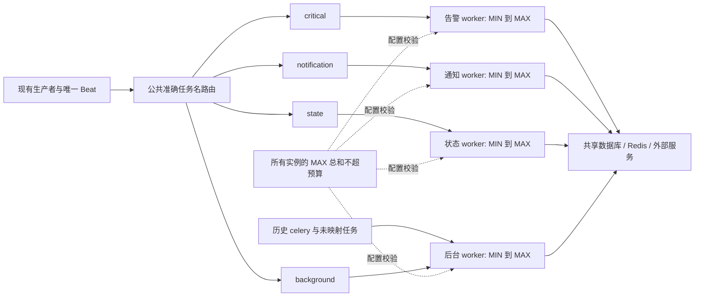

## Context

本计划只调整 Celery 运行架构，不实施业务优化。依据本地版本 `dd39ab8c23dcbf29b0548e2a9347bb24c9880fe3`、[88 项任务清单](../../../docs/celery-task-inventory-and-resource-isolation.md)及用户提供的线上队列截图制定；线上版本与本地不完全相同，上线前必须重新核对。

当前证据：

| 事实 | 确认位置 |
|---|---|
| 一个 threads worker，无显式消费队列，启动默认并发 4 | `server/support-files/release/supervisor/celery.conf`、`startup.sh` |
| 公共配置未提供任务队列和路由；配置并发 2 被启动参数覆盖 | `server/config/components/celery.py` |
| 自动发现任务；静态周期任务同步到数据库 | `server/apps/core/celery.py` |
| 应用和 NATS 默认分别 8、4 个进程，也占整机资源 | `server/support-files/release/startup.sh` |
| 整机 16–32GB 包含全部组件 | 用户提供的部署约束 |
| Redis `/3` 的基础 `celery` 队列长 11,072；头部 500 条中节点收敛占 471 条 | 用户截图，2026-10-30 |

截图脚本是只读采样，不是清空消息。94.2% 仅代表这 500 条消息的数量占比，不代表整个队列或执行时间占比；普通 Redis 入队通常从列表头写入，需补采尾部才能判断老消息。该长度也不含其他优先级列表、已预取、执行中及 ETA 消息。

## Goals / Non-Goals

**Goals:**

- 依据时效和资源特征分配执行池，让节点任务和重后台任务不能占用告警池的 Celery 执行槽位。
- 在 16–32GB 全组件同机环境提供明确的进程数、总并发预算和容量验收方法。
- 用公共配置完成路由，覆盖静态 Beat、动态 Beat、普通异步调用及存量消息迁移。
- 保留现有业务行为，提供可观察、可验证、可回滚的部署流程。

**Non-Goals:**

不改任务函数、触发频率、任务参数、业务数据库模型、节点收敛去重、CMDB 关联计算、监控补算、通知业务流程、导出实现、远端执行与取消行为。不全局修改 ACK、自动重试、结果保留期限或任务过期策略。不引入新调度平台、常驻监控服务或按模块拆分全部后端服务。

## Decisions

### 1. 按工作负载划分四个逻辑队列，不按业务模块各起一个 worker

| 队列 | 职责与候选任务 | 隔离目的 |
|---|---|---|
| `critical` | 告警聚合、检测扫描、提醒/升级检查、即时告警构建/分派 | 保留告警链路的执行机会 |
| `notification` | 已有独立通知、补偿通知、动作投递及结果回调任务 | 资源允许时隔离外部 I/O 等待 |
| `state` | 节点收敛/安装控制、作业调度与取消收敛、CMDB 周期状态收敛 | 将截图中的节点流量与告警隔离 |
| `background` | CMDB 关联、批处理、采集、训练/知识处理及其他非关键任务 | 收敛重负载并发，承接默认任务 |

具体候选路由见 [task-routing-plan.json](task-routing-plan.json)。四类分别为 8、9、9、62 项，共 88 项静态定义；后台 62 项中 4 项原清单标为 U（未证实生产异步触发/空壳/旧入口）。路由表不激活这些任务，不添加调度器。MLflow 状态轮询、错误日志写入从旧报告 I 类调到后台，避免占用通知专用槽位。原报告 C 类拆成告警与状态两类，A 类暂归后台。

这是运行分组，不代表队列内任务都很短：扫描中同步通知仍在 `critical` 执行，安装编排仍在 `state`，回调和通知仍可能相互等待。直接调用任务函数不会经过 broker，路由不能改变其执行位置。模块归属只用于责任人和指标维度。

替代方案：按模块拆池会重复加载 Django 和全部已安装应用，内存成本过高；一个 worker 消费四个队列仍共享槽位；只设消息优先级不能抢占正在执行的任务。故采用少量队列配独立进程。

### 2. 一套通用配置，四个独立 worker，池内弹性伸缩

不提供 compact/isolated 等部署档位，不按 16GB/32GB 选择两套拓扑。每类一个独立 worker，最小/最大并发均为部署参数：

| worker | 消费队列 | 最小并发 | 最大并发 |
|---|---|---|---|
| 告警 | `critical` | `CELERY_CRITICAL_MIN` | `CELERY_CRITICAL_MAX` |
| 通知 | `notification` | `CELERY_NOTIFICATION_MIN` | `CELERY_NOTIFICATION_MAX` |
| 状态 | `state` | `CELERY_STATE_MIN` | `CELERY_STATE_MAX` |
| 后台 | `background,celery` | `CELERY_BACKGROUND_MIN` | `CELERY_BACKGROUND_MAX` |

每池 `1 ≤ MIN ≤ MAX`，MIN 保留执行机会，MAX 限制突发扩容。并发 1 只是允许的下界，不是够用的结论；MIN=MAX 表示该池固定容量，仍使用同一配置结构。生产值必须显式填写并通过容量验收，不以未测量的 1/1/1/1 静默兜底。

**实现选择：Celery 5.4 原生 prefork autoscale。** 仓库 `server/pyproject.toml` 锁定 5.4.0；核对同版本 `concurrency/thread.py`，其 ThreadPoolExecutor 没有 grow/shrink 实现，`worker/autoscale.py` 伸缩依赖 pool.grow/shrink。官方说明支持 prefork/gevent，不能对现有 threads 加参数就宣称已实现弹性。[Celery 5.4 文档](https://docs.celeryq.dev/en/v5.4.0/userguide/workers.html#autoscaling)

worker 命令由公共配置生成，例如 `--autoscale=${MAX},${MIN} -Q critical -n critical@%h`；执行池类通过 `CELERY_WORKER_POOL` 加载（Celery 5.4 CLI 的 `--pool` 只接受固定别名，不能直接传类路径），supervisor 中百分号按其规则转义。顺序必须是 MAX,MIN，不再混用 `--concurrency`。四个 worker 主进程一直存在，伸缩的是子进程；这比当前线程池增加进程成本，不称为零成本扩容。

原生 autoscaler 根据 worker 内部待处理需求伸缩，不是按全局 Redis LLEN 或排队 SLO 自动规划容量。缩容只回收可退出的空闲子进程，繁忙时延后，不强杀正在执行的任务。拟暴露 `AUTOSCALE_KEEPALIVE`（初始候选 60 秒）避免刚扩就缩；其含义是原生收缩等待机制，不能描述成连续空闲 60 秒或全局扩容速率限制。具体时间通过突发测试调整。

所有 worker 显式 `-Q`、独立 `-n`；替换旧 `celery.conf`，禁止旧全队列 worker 意外同时启动。Beat 保持部署范围内单实例。



本阶段不实现跨池动态借用额度、不新增中央伸缩服务、不修改线程池私有字段、不改 gevent/全局 monkey patch。独立静态上限虽然不能借用其他池的空闲预算，但易于审计，避免多个 autoscaler 同时扩容突破总预算。共享数据库、CPU 和 broker 仍可能相互影响，槽位隔离不等于资源完全隔离。

### 3. 公共路由统一管理，生产者显式覆盖必须可见

- 公共配置声明四队列，按完整任务名精确匹配；生产默认队列保持 `celery` 并交给后台池，未映射任务发出限频诊断。不用 `apps.cmdb.*` 等模块通配符代替分类。
- 发布前校验已安装应用的任务注册表、实际生产者调用和启用的 `PeriodicTask`。数据库 `queue/exchange/routing_key`、调用参数中的显式路由可能覆盖公共路由，必须报告并核对最终投递目的地。
- 如需修正持久化调度的路由，仅通过 Django ORM 对明确名单更新路由字段，提供 dry-run、变更前快照和逆向恢复；不改任务名、启停、参数或周期。静态配置同步再次运行后仍须验证有效路由。
- 上线版本包含而本地不存在的七个任务名列在候选清单中，目标队列留空。取到实际注册和实现证据后才能分类，不按 `transfer`、`outbox` 等名称猜测。不能靠路由解决未注册任务问题。
- 对启动失败采用明确诊断；对运行时新出现但已注册的未映射任务采用后台兜底并告警，不丢弃消息。

### 4. 弹性上下限和总预算集中校验

新增四组 `CELERY_<POOL>_MIN/MAX`、`CELERY_TOTAL_CONCURRENCY_LIMIT`，使用同一解析器输出 supervisor 命令与诊断结果。实施配置另外声明 `CELERY_WORKER_REPLICAS`（默认 1）；多实例时显式填写 `CELERY_RUN_BEAT`，部署层保证只有一个实例为 true。总预算校验采用所有可能同时运行实例的 **MAX 之和**，不能只校验 MIN 或当前活跃数。单副本时即四池 MAX 求和；多副本和升级重叠必须显式计入，由部署清单审查，不假装单机环境变量能协调未知副本。

参数示意（仅展示格式，不是生产容量推荐）：

```text
CELERY_CRITICAL_MIN=1       CELERY_CRITICAL_MAX=2
CELERY_NOTIFICATION_MIN=1   CELERY_NOTIFICATION_MAX=2
CELERY_STATE_MIN=1          CELERY_STATE_MAX=2
CELERY_BACKGROUND_MIN=1     CELERY_BACKGROUND_MAX=1
CELERY_TOTAL_CONCURRENCY_LIMIT=7
AUTOSCALE_KEEPALIVE=60
```

该示例低负载时有 4 个 worker 主进程 + 4 个执行子进程，高负载最多 4+7 个进程，另加 Beat 和应用等进程；不能按“只有 4 个进程”做内存预算。真实 MIN/MAX 与总上限按下一节确定。每次改上限都重做容量校验；本阶段通过配置发布更新范围，不开放可绕过预算的自助远程 autoscale 接口。

现有 `CELERY_CONCURRENCY` 从新运行配置移除，升级文档明确替换成各池 MIN/MAX；检测遗留歧义配置时报错，不复制成每池并发。范围缺失、非正整数、MIN>MAX、MAX 总和超预算、重复/遗漏消费者均启动前拒绝。关闭 Celery 的既有部署行为不变。

预取初始设为 `worker_prefetch_multiplier=1`，与 autoscale、当前 ACK、ETA 一起用真实 broker 验证实际驻留数量；预取可能按最大并发计算，不能声称只预取 MIN 条。禁止设为 0。保留 ACK、retry 和任务过期语义。

**切换 prefork 的准入检查：** 只在公共运行层处理 fork 后连接初始化和指标进程边界，验证 Django 连接、NATS/HTTP 客户端、模型库、进程内缓存/锁以及任务内部线程池。盘点任务装饰器和有效配置中的 time_limit、soft_time_limit、max_tasks_per_child 等，避免以前 threads 未支持的设置突然改变运行行为。仓库当前 `CELERY_MAX_TASKS_PER_CHILD=5` 不能机械转换成生效的 `worker_max_tasks_per_child=5`；本次不新增按任务次数频繁回收或全局强杀超时。若保持业务契约必须修改任务实现，则记录阻塞并交业务负责人，本计划不越界修业务。

### 5. 并发由吞吐测算，内存按最大容量验收

每池采集到达速率 λ（条/秒）、平均执行时间 E[S]（秒）、耗时分位数和突发长度。`ceil(λ × E[S] / 目标利用率)` 作为 MIN 的粗略起点，利用率需小于 1 并保留余量；它不是尾延迟保证。MAX 还须满足积压 Q 在目标 T 内消化：近似要求 `MAX / E[S] > λ + Q/T`。混合长短任务、CPU 限制、扩容启动时间和共享依赖都可能使公式失效，最终以压测为准。若所需 MAX 超过资源预算，报告容量缺口，不用弹性掩盖长期供不应求。

估算框架：`整机峰值 ≈ 非 Celery 组件峰值 + 四个 worker 主进程 + 所有 MAX 执行子进程的工作集 + broker/结果存储增量 + 安全余量`。使用容器 cgroup 实际内存和整机可用内存作为主指标，PSS/RSS 辅助定位；不可简单相加 RSS 后声称得到精确物理内存。

- `-Q` 不减少已安装应用的导入；四个 worker 主进程及弹性子进程会增加 Django、连接池和可能的模型库成本；fork 写时复制节省量须实测，不能假定完全共享。
- 执行子进程数不等于系统总线程数或数据库连接数。任务内部线程池、APP_WORKERS、NATS、数据库、图库、算法服务和缓存均纳入测量。
- 不修改 APP_WORKERS/NATS/数据库参数或业务内部线程池默认值；将实际值记录进容量报告，若不满足预算，在保留时效验收目标的前提下调整 MIN/MAX 并重新验收；若无法兼顾，明确现有部署无法容纳要求。
- 启动风暴、稳态、长任务、积压消化、正常重启及升级短暂重叠都要测。容器内多个 worker 共享 cgroup，进程分离不提供单池硬内存配额；当前阶段不增加四套应用容器。
- 上线前填写整机和应用容器上限、基线、峰值、余量、测试负载和结果。不得仅凭“16GB 可用”直接填入上限，或通过丢消息降低 Redis 内存。原生 autoscale 不感知整机可用内存，安全性依赖全部 MAX 同时运行的容量预算；它不是实时内存保护器，也不能阻止单个异常任务 OOM。

### 6. 公共观测只描述运行状态，不改变任务业务

复用现有日志/监控接入，公共 Celery 生命周期钩子记录发布、开始、结束、失败和重试；记录队列、有限任务名、worker、耗时和结果状态，禁止记录参数、凭据或消息正文。高频成功事件采样，计数保留完整口径；观测失败不能阻断任务或掩盖原异常。

发布头携带时间供排队时延计算；重试须重新计时并可识别尝试次数。ETA/countdown 的等待按 `开始时间 - max(本次发布时间, 计划执行时间)` 计算，缺少时间的旧消息标为未知，不能记为 0；进程执行耗时使用单调时钟，跨进程时钟偏差单列诊断。公共头不改任务参数签名。

只读诊断输出各队列 ready、active/reserved/scheduled 可用信息、发布/完成速率、最老可观测等待年龄、P95/P99、失败/重试、worker 心跳和内存。明确 broker 的优先级子队列、unacked、ETA 统计边界，无法取得的数据标为未知；禁止用单个 LLEN 当全部待处理数。高基数 task_id/node_id 不作指标标签；任务名限定注册清单，未知名归类。

## Risks / Trade-offs

- [节点洪峰仍可能持续积压] → 本变更不去重或减少业务发布；用容量指标暴露，业务团队另行治理。不能承诺无限流量下 broker 内存稳定。
- [同池长任务阻塞] → 记录实际池内等待；关键扫描自带同步通知，拆通知队列不会拆开该调用链；不把业务拆分作为本次验收条件。
- [共享数据库/Redis/CPU 被压满] → 整机压测同时观察依赖延迟；槽位隔离不能消除共享依赖竞争。
- [MIN 过小或扩容启动慢导致尾延迟] → 依据到达速率、耗时与突发测试确定 MIN/MAX；延迟敏感池保持足够热容量，不把 MIN=1 当推荐结论。
- [历史任务仍留在 celery] → 新路由不移动旧消息；后台排空期间历史告警仍可能等待，关联锁也可能继续阻止新的同类任务。不得自动清锁或承诺切换后历史任务立即恢复。
- [prefork 内存与兼容性成本] → 验证所有池同时达到 MAX、收缩后内存回落及反复伸缩；兼容性/容量不通过则不发布，不暗中改回无伸缩的 threads 后声称完成。

## Migration Plan

1. **冻结事实基线**：确认线上镜像/commit、启用模块、真实任务注册和路由覆盖、broker/依赖版本、队列头尾与增长趋势。整理七项线上差异并完成分类；不要求修改其业务代码。
2. **测试环境准备**：生成唯一 supervisor 配置，准备只读诊断和路由字段 dry-run；真实 Redis 多 worker 验证任务只被指定池消费，随后在目标整机配置上验证 prefork 兼容性、MIN 稳态与全池同时 MAX 的内存和吞吐。没有实际环境的数据保持待验，不写成通过。
3. **消费者先就绪**：制定维护窗口与生产者切换顺序。停止旧 worker 获取新消息并温和排空活动任务，再启用新拓扑；如确需短暂重叠，旧 worker 只消费历史 `celery` 且计入临时内存/并发预算。预算不允许则串行切换，接受记录在案的短暂停顿。不得直接杀死执行中的远端操作。
4. **切换生产者**：验证新消费者就绪后启用准确路由及已审查的持久化路由变更；唯一 Beat 的滚动顺序纳入部署步骤。混合版本仍发到 `celery` 的消息由后台处理，不能宣称全部生产者已隔离。
5. **排空与观察**：后台持续消费旧队列；监控未知路由、时延、Redis 内存和任务失败率。保持原始消息，不 purge、不批量重发、不因超龄丢弃；如存量业务任务本身不安全，由责任开发确认，架构脚本不推测。
6. **回滚**：回退生产者路由和已变更的调度路由字段，同时保留新队列消费者直至排空。若回退到旧单 worker，必须先验证该版本可显式消费 `critical,notification,state,background,celery` 并注册所有积压任务；承认回滚恢复共享池竞争。仅回退镜像/路由而停掉新队列消费者不是完整回滚。恢复过程中仍遵守内存预算、单 Beat 和活动任务排空要求。

## Acceptance / Verification

| 验证项 | 可复现条件与通过标准 |
|---|---|
| 路由契约 | 启用应用的实际注册任务、普通调用、Beat 数据库显式覆盖及未知任务兜底均检查最终队列；88 项候选仅作为初始审查材料 |
| 执行池隔离 | 测试专用阻塞任务占满 state/background；critical 任务仍可开始，执行 worker 身份正确；notification 占满也不占 critical 槽 |
| 弹性与预算 | 真实 broker 下从 MIN 扩到 MAX、空闲缩回 MIN，繁忙子进程不被杀；全池同时扩容仍满足 MAX 总预算；核对 prefork 冷启动与依赖兼容性 |
| 初始时延目标 | 在记录 CPU/内存及关键池自身负载未饱和的条件下，跨池压力场景关键任务排队 P95≤5秒、P99≤15秒；持续至少30分钟、至少1000个探针，记录发布速率、任务运行时长、负载配置和测量口径。此为待验证发布目标，不是线上承诺 |
| 资源 | 按预先填写的整机/容器预算运行至少一个代表性业务峰值窗口；无 OOM、重启循环或内存持续增长失控；报告无法覆盖的生产规模，不用短压测推断长期无泄漏 |
| 迁移回滚 | 混合版本、存量队列、多队列积压、ETA、重试与在途任务均演练；无因路由切换导致的无人消费、消息清空或额外重复发布 |
| 行为边界 | 不改业务函数/模型/周期/参数；不新增全局重试、ACK 或丢弃策略；公共观测失败不影响任务 |

架构测试用测试专用任务制造阻塞，不向真实主机下发作业。实施阶段先写行为测试，再修改公共配置；执行 `cd server && make test` 并满足仓库改动代码覆盖率要求。计划阶段不运行后端实现门禁，不将计划校验当作运行验证。

## Open Questions

- TODO: 线上七个差异任务的真实职责与注册版本。确认位置：线上镜像 `apps.*` 源码、Celery `inspect registered` 与截图；见候选路由 JSON 的 `production_only_pending`。
- TODO: Celery/Kombu 精确运行版本、实际 Redis 优先级/预取行为及部署副本数。确认位置：线上依赖锁定信息、`inspect conf/active_queues`、部署清单；输出须脱敏。
- TODO: OpsPilot/MLOps 启用情况、各组件峰值及容量余量。确认位置：线上 `INSTALL_APPS`、容器资源配置和峰值监控；本计划不预设算法库内存。
- TODO: 历史队列耗尽所需时间和在途任务安全停止边界。确认位置：线上头尾样本、完成速率、active/reserved/scheduled 与既有远端作业运行手册。

以上是实施/上线核验项，不阻止设计评审；未核实前不能把候选路由或弹性参数当成可直接发布配置。

## Implementation Status

实施内容、验证证据和待完成上线门槛见 [implementation-evidence.md](implementation-evidence.md)。审查后增加公共 prefork 兼容池：保留七个 MLOps 任务等现有超时声明，在执行池提交边界忽略原 threads 不支持的软/硬超时与回收选项，不修改任务属性、消息或业务函数。启动检查验证兼容池配置，运行巡检核对实际池类型；不因已有声明阻断全模块启动。Django 与启动器共用 `.env` 加载器，已导出的环境变量优先。
