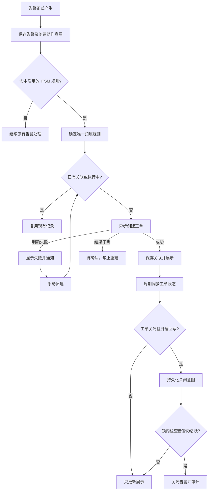
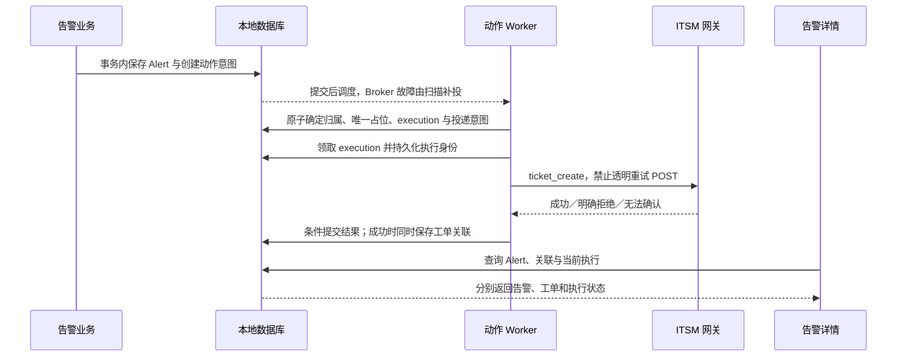
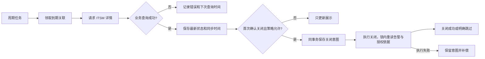

# 告警处理：转 ITSM 工单

Status: in-progress

日期：2026-09-23；暂停留档：2026-10-08；接口文档续接：2026-10-27。

2026-10-27 对照《bklite_expand 告警转工单接口》（插件 `bklite_expand` 0.0.2，包 `bklite_expand_20261026_174500.tar.gz`）。本地暂存已应用到 `feature_windyzhao`。评论接口本期不做：用户明确要求不更新评论。文档第 4 节的 `ticket_comment` 不进入实现。

实施进度（2026-10-08 暂存）：按用户要求暂停，保存阶段实现，待补充 ITSM 接口文档后继续。本地业务链路框架、数据库增量迁移、集成表单内连接测试及测试通过后允许启用已实现；后端实际响应契约适配和规则配置交互仍未完成，不能称为用户可用的完整实现。真实环境登录与列表查询曾通过，文档中的两个流程均返回不存在，真实建单、状态流转及关闭回写尚未验收。配置使用问题、修订流程和测试功能要求以 [配置与使用流程复核](configuration-review.md) 为准；第 15 节仅记录当前实现及历史验证，不代表最终交付验收。

### 暂停点与续接入口

- 已实现：全局 ITSM 地址、认证和 CA 配置；在表单内测试当前输入，测试成功后允许启用，修改连接参数后需重新测试；异步建单、关联展示、状态同步、可选关闭回写和失败补建的本地框架及自动化测试。
- 待调整的规则表单：同一团队仅一个集成，移除集成选择；改为选择流程，再配置“流程建单字段 ← 告警字段或固定值”。当前仍是集成选择、手填流程标识和字段映射，尚未完成上述交互调整。
- 2026-10-27 文档已确认、可以按此改客户端的部分：基址 `https://<WeOps X>/openapi/v1/itsm/bklite_expand/api/v2`，只带 `Authorization: Bearer` 个人令牌；成功包络是 HTTP 200 且 `code=20000`（文档未给出 `result` 字段）；`GET ticket_form/?workflow_key=` 从 `canvas_data.form_data.layout` 取字段 Key，跳过 `row`/`group`/`tab`/`tab-panel`；`POST ticket_create/` 必须带 `workflow_key`、`is_submit=true`、`form_data`，告警侧保存返回体里的工单 `id`（创建响应的 `data` 是工单对象，单号当时可能仍是草稿号）；`GET ticket_detail/{id}/` 从 `data.ticket` 读 `id`、`sn`、`title`、`status`、`status_display`、`end_at`。不调用 `ticket_update`、`ticket_handle`、`tickets_revoked`。
- 仍不能闭环的部分：`GET ticket_list/` 从 2026-09 的八接口起就有，返回的是工单，不是流程。2026-10-26 插件 `api/v2.py` 的路由里也没有流程目录；`ticket_form` 必须先带 `workflow_key`。规则仍只能手填已发布流程标识，再用 `ticket_form` 读字段。文档只给出实测状态 `running` / 处理中，`end_at` 为空表示未结束，没有结单、终止或其他终态枚举，因此“工单关闭后关闭告警”不能启用；`multiUser` 等字段的值结构、必填和枚举选项没有定义。`end_at` 非空不能当成结单。
- 拿到结单状态语义和流程列表（或确认继续手填流程标识）之后：补齐客户端响应适配和字段映射校验，再验收真实建单 → 关联展示 → 周期同步；关闭回写单独等终态契约。明确失败补建、结果不明防重复仍按原规则。
- 连接测试通过仅证明连接与认证可用；当前业务响应契约未齐全，规则校验和业务调用仍保留限制。自动化测试通过不等于真实 ITSM 闭环验收通过。
- 暂存前验证（2026-10-08）：`test_itsm_*.py` 共 102 项通过；集成表单、规则字段和工单详情面板前端测试共 17 项通过。本次未新建真实工单或重跑真实环境闭环。

最新范围更新（2026-09-24）：用户明确取消追加留言及工单 URL 返回／页面跳转。当前范围以本文为准；[历史能力补充清单](itsm-handoff-and-test-data.md)中的 M1 留言、D3 页面链接和对应测试不再是本期要求。现有创建、详情、列表／搜索接口足以开始实施；真实流程字段、状态映射及告警侧通知配置在开发联调中落实。实施就绪不等于已经实现或通过验收。

## 1. 目标与范围

本期完成：**规则触发建单 → 保存关联 → 详情展示 → 周期同步 → 可选关闭告警 → 明确失败后的手动补建**。

仅针对告警中心的单条 `Alert`，一告警一主工单。告警中心持有告警事实，ITSM 持有工单事实；工单信息是告警的关联展示，不进入告警主状态枚举。

本期不做：

- Incident 建单、一张工单关联多条告警。
- 追加留言、留言去重／失败重跑、为留言新增的生命周期操作快照。
- 工单 URL 返回、保存和页面跳转；详情仅展示工单名称、ID、业务编号和同步状态。
- 告警恢复或关闭后推动 ITSM 流程、修改处理人、终止或办结工单。
- Webhook 动作、双向字段同步、通用多工单平台框架。
- 对任意未命中规则的告警临时选择流程建单；手动补建只处理已有归属规则的失败建单。
- 结果不明时盲目重试创建，或承诺非幂等接口上的自动“恰好一次”。

## 2. 已确认的业务规则

### 2.1 配置与归属

管理员配置规则名称、所属团队、启用状态、告警匹配条件、ITSM 流程与表单映射，以及“工单关闭后关闭告警”开关。关闭回写默认关闭。

ITSM 类型只处理“创建”，页面固定必选创建，不展示分派、认领、恢复、关闭留言选项。保留作业类型，移除动作类型中的 Webhook 选项；不影响告警来源或通知渠道中的 Webhook。

多条 ITSM 规则同时命中时，按规则 ID 升序只取第一条，作为该 Alert 的归属规则；作业规则仍按原有逻辑执行。不得由多个 ITSM Handler 各自竞速决定归属。命中首条后，即使其配置有误，也记录该规则的失败，不静默改用另一流程。

同一 Alert 无论由自动还是手动入口触发，最多成功关联一张主工单。已关联的工单关闭后仍不新建；新的 Alert 可以建立自己的关联。

### 2.2 自动建单

告警正式产生时，保存告警和创建动作投递意图。后台匹配规则，取得唯一建单资格后调用 ITSM。

- 成功：记录工单 ID、业务编号、名称，进入状态同步。
- 明确失败：显示原因、记录执行结果并通知，允许符合条件的手动补建。
- 结果不明：显示“结果待确认”，阻止新创建请求，进入核查流程。

任何 ITSM 网络错误都不阻断告警产生、分派、恢复或关闭。它不免除本地事务的一致性：本地事务本身失败不能报告告警已成功保存。

### 2.3 手动补建

手动入口复用同一唯一关联和异步建单链路，返回执行 ID 和受理状态，不在 Web 请求中等待 ITSM。

| 状态 | 行为 |
|---|---|
| 已有归属规则，前次明确失败 | 有权限者可提交新的建单尝试 |
| 排队或执行中 | 返回现有执行，不重复提交 |
| 已有主工单 | 返回现有关联，不再新建 |
| 结果待确认 | 禁止直接重建，先核查 |
| 未命中规则、没有建单记录 | 本期不提供临时选流程建单 |

成功之前的历史执行保留，新尝试不得覆盖旧失败原因和操作人。不同用户同时补建、自动任务重投与手动请求竞争，也必须服从 Alert 级唯一约束。

网络重放与用户再次补建必须区分：同一次补建使用稳定的 `Idempotency-Key`，重复请求始终返回原执行，即使它已经明确失败；用户再次点击补建才提交新 key。后端仍锁住唯一关联，只有其当前执行明确失败且请求权限有效时才能生成新尝试，不能只依赖请求 key 防并发。

### 2.4 状态展示与同步

详情读本地关联和最近一次同步结果，显示告警状态、工单状态、建单结果、同步是否正常及最近成功同步时间。列表可增加关联标识，不替换告警状态列。

同步周期默认 5 分钟，统一可配置。按到期时间分批处理，限制并发、超时和响应大小。告警已恢复或关闭但工单未结束时，仍继续同步。

查询失败时保留上次工单状态，明确展示过期或失败信息；401、403、404、未知状态码不能解释为工单关闭。关闭状态集合必须由 ITSM 实际流程契约确认，不能把任务状态 `running/suspend` 当成工单状态。

### 2.5 工单关闭后的告警处理

- 开关关闭：只更新展示。
- 开关开启且 Alert 为 `unassigned/pending/processing`：执行现有关闭语义，状态变为 `closed`。
- Alert 为 `resolved/auto_recovery/closed/auto_close`：只更新展示，不覆盖告警状态。
- 关闭回写失败保留待处理意图，后续补偿；不能因本地已经缓存“工单已关闭”而漏掉关闭动作。
- 同一次工单关闭事实只处理一次。原 Alert 重新打开后，不因旧工单仍关闭而再次自动关掉它。

告警先恢复时照常自动恢复，不等待 ITSM、不留言、不关工单；超时自动关闭同理。未结束的工单继续同步状态供展示。

## 3. 业务链路



## 4. 数据职责与最小模型

沿用 `Alert`、`ActionRule`、`ActionExecution`、`AlertOutbox`，新增 `AlertItsmTicket`。不另建通用事件表、工单动作引擎或独立重试系统。

| 对象 | 权威职责 |
|---|---|
| Alert | 告警内容、团队、处理人及现有主状态 |
| ActionRule | 匹配条件、流程、字段映射、关闭回写配置 |
| AlertItsmTicket | 唯一绑定、归属依据、外部工单信息、最近同步结果及关闭回写处理结果 |
| ActionExecution | 每一次本地建单尝试的状态、实际输入快照、操作者和结果 |
| AlertOutbox | 持久投递意图、调度及安全重试；delivered 不等于建单成功 |

关联在发请求前作为占位记录创建，`alert` 设置唯一约束；成功后填入远端 ID。成功关联的 `(ITSM 实例标识, ticket_id)` 也需唯一，避免核查补录时把同一工单挂到两个 Alert；未建单的空值不参与远端工单唯一性判断。实例标识代表同一套 ITSM 的工单命名空间，不能使用账号、令牌或凭据版本代替；凭据轮换及网关地址变更不应改变它。本期可在既有连接配置中保存稳定标识，不为此新增连接管理产品。

关联保存以下最小信息组，具体字段名在实现时确定：

- 本地：Alert、归属规则及其必要名称快照、有效团队、当前创建执行引用。
- 建单依据：连接引用、流程标识、成功建单采用的策略快照；实际表单输入以对应 execution 为准，不重复存多份。
- 工单：字符串类型的 ID、业务编号、名称；不保存详情页 URL。
- 同步：原始状态码、展示名称、关闭判定、最后成功时间、下次同步时间、失败摘要。
- 回写：未处理／待处理／已关闭告警／跳过及原因，不混入工单状态。

创建进度以 `ActionExecution` 为准，页面从当前执行推导；不在关联表再维护一份独立创建状态机。ITSM 执行支持 `pending/running/success/failed/config_error/unknown/skipped`，其中 `unknown` 仅表示结果待确认，不修改作业现有状态解释。各状态允许的操作见第 13.2 节。

凭据不进入规则 JSON、execution、outbox、URL 或日志，只保留服务端连接／凭据引用。工单 ID 和业务编号必须为字符串，避免前端长整数精度丢失。

## 5. 创建数据链路



ITSM HTTP 请求在本地事务提交之后执行，不在数据库锁内等待。首条规则的归属、占位、执行记录和可恢复执行意图必须原子持久化；不能留下“执行记录已存在，因此重投被跳过，但从未调用 Handler”的悬空记录。

明确失败与结果不明按“能否证明未产生工单”区分，不只看 HTTP 状态码：

| 证据 | 结果分类与后续 |
|---|---|
| 本地字段校验失败，尚未发送 | 明确失败，修正后可手动补建 |
| 已验证的网关拒绝／ITSM 校验拒绝，契约保证未创建 | 明确失败，修正后可手动补建 |
| 请求读取超时、连接中断、非预期 5xx、成功响应缺 ID | 结果不明，禁止自动重建 |
| ITSM 返回成功，但本地关联保存失败 | 结果不明，核查远端结果 |
| Worker 在可能已发送之后失联或执行租约到期 | 结果不明；接管者不能重新发送创建 |

Outbox 可重复调度同一执行，但执行状态必须阻止重复发送非幂等创建请求。领取和回写使用条件更新／执行令牌；迟到结果不得无条件覆盖新执行或已核查结果。运行中任务过期不直接恢复成可发送状态。

建单结果待确认的具体核查入口见第 8 节。标题搜索只能辅助查找，不是唯一性或“未创建”的证据。

已经取得可信工单 ID 时，编号、名称或状态暂缺属于展示信息未补齐，不能把创建降级为可重试失败；先保存成功关联，再通过详情查询补齐。首次尚未查询到状态时展示“状态待同步”，不猜测为处理中或关闭。

## 6. 同步及关闭的数据链路



同一关联避免并发轮询；同步结果按领取代次条件提交，较早请求迟到不能覆盖较新状态。同步失败推进下次重试时间并有界退避，故障不能让每个扫描周期反复打满 ITSM。

关闭意图与“发现工单关闭”的本地记录同事务保存。执行关闭前重新验证关联、团队、规则是否仍允许执行，并锁内读取 Alert 的当前状态。若允许 ITSM 重开且关闭动作已延迟，需要重新查询确认仍关闭再执行；本期不承诺两套系统之间的原子状态切换。

关闭处理结果独立于展示状态保存：无论执行成功还是因告警非活跃而跳过，同一关闭意图均不再重复应用。Alert 状态变更、关闭处理结果、审计以及需要派发的 closed 动作意图须在同一数据库事务提交；不得先关闭成功，再另一个事务标记已处理。外部副作用仍在提交后执行。若告警不活跃则在锁内记录跳过，不派发新的 closed 动作。暂时错误可重试，权限或配置错误可查、可通知，不能假装已成功处理。

关闭执行同时遵守“绑定保存的开关为开”和“当前归属规则仍允许后台执行”两个条件。前者决定是否授权过该工单回写，后者只收紧权限；不能重新读取规则的新开关来追溯授权旧工单。规则改为非 ITSM 类型、团队范围不再兼容或连接身份失去相应权限，均停止回写，不扩大授权范围。

## 7. 2026-09-23 方案复查：必须修正的实现缺口

以下是核对当前代码后发现的问题，修订已写入对应链路；不是对现有实现完成情况的声明。

| 问题与具体触发条件 | 修订方向 | 当前代码证据 |
|---|---|---|
| 直接调用人工关闭会拒绝后台身份，且不能关闭未分派告警；`api_close` 也仅允许待响应、处理中 | 在告警操作模块内复用关闭状态变更及副作用，提供仅受信后台可调用的 ITSM 关闭入口；依据绑定与规则授权，不伪造处理人、不放宽现有 Web/OpenAPI 人工权限 | `service/alter_operator.py::_close_alert` |
| 执行记录先保存，进程在 Handler 前退出；引擎重投遇到唯一键直接跳过，建单永久悬空 | ITSM 分支原子保存归属、execution 与可恢复投递意图；待执行记录可被重新领取，执行过的记录不能重新发送 | `action/engine.py::_dispatch` |
| 部分创建入口在 `on_commit` 回调中才新增 Outbox，提交后崩溃可能永久漏掉动作 | 核对正式创建、聚合及会话转正入口，将本期创建意图落在业务事务内；提交后只负责唤醒任务 | `aggregation/builder/alert_builder.py`、`service/alert_lifecycle.py` |
| 异步匹配读取的是 Alert 当前状态，分派／恢复可能先发生，使本来匹配创建的规则漏掉 | 在正式创建时保存 ITSM 匹配及传参所需的有界输入快照；不复制完整 Event/raw_data，不改变作业已有匹配口径 | `tasks/action_tasks.py`、`action/engine.py`、`action/payload.py` |
| Worker 或 HTTP 客户端自动重试非幂等创建可能重复建单 | 划分明确失败与 unknown；检查 HTTP、任务和代理层的 POST 重试行为；过期 running 不自动重发 | `service/outbox.py` 与用户提供的 ITSM 调用说明 |
| 永远使用旧配置快照时，修正必填字段后补建仍失败 | 已成功绑定保持不变；明确失败后的新尝试可读取同一归属规则的修正配置并保存新 execution 快照，见第 8 节补充处理原则 | `models/action.py`，上一版方案的快照约定 |
| 缓存关闭状态成功后，本地关闭失败；下一轮只判断“状态有无变化”会漏掉回写 | 独立持久化关闭处理结果和待执行意图，允许补偿；执行成功或明确跳过才结束意图 | 本文第 6 节 |

关闭入口需验证关闭时间、活跃指纹释放、提醒／升级停止及原有 closed 动作是否仍按既有语义执行。当前 `Alert.save` 会释放非活跃指纹，但不能据此推断其它副作用齐全。不得用直接 `QuerySet.update(status=...)` 代替完整关闭语义。

ITSM 建单处理不消费 closed 事件，不实现留言逐次去重；其它既有作业规则若配置了 closed，仍保持现有关闭事件行为。不为本期修改所有生命周期事件或全局更改作业幂等键。

## 8. 已确认的补充处理原则与待落实事项

本节的补充处理方向已获用户认可；仍需外部证据或具体配置的事项继续标明，不能由实现自行假定为存在。

### 8.1 结果待确认的出口

提供有权限的运维核查入口：填写实际工单 ID 后，后台经原连接读取详情，校验团队、是否已被其它 Alert 绑定，并展示核对信息；核查人确认关联依据后补录绑定，保留审计，进入正常同步。不能仅因为“能查到工单”就自动判定它属于该 Alert。入口仅用于已有 unknown 执行的结果核查，不能用于任意换绑成功工单；核查提交时锁内重读当前执行和关联，远端工单重复绑定由数据库约束裁决。

若仍查不到，不提供普通用户“一键认定未创建并重试”。列表为空或标题无匹配不能证明迟到创建不会发生。只有 ITSM 侧能提供该请求已结束且未创建的可靠证据，才可由受控核查流程解除 unknown；现有八接口未证明能提供该证据，因此该分支仍可能需要人工支持，不能宣称完全自动闭环。

晚到响应、核查补录与任务恢复必须互斥裁决，不能各自覆盖关联。

### 8.2 规则和配置变更

采用以下原则：

- 建单成功后冻结连接、流程和关闭回写开关快照；规则修改只影响未来建单，不批量对存量工单追溯开启关闭告警。
- 明确失败的手动补建使用同一归属规则的最新有效表单配置；保存新尝试快照，页面让操作者看到实际采用的流程。已有成功／unknown／running 时不允许换配置重新发送。
- 停用或删除规则后，取消尚未发送的创建，停止新的补建和关闭回写，继续同步已有工单供展示；已在途请求只能接收其结果，不能假定远端取消。
- 因停用而取消的关闭意图不在重新启用后自动追溯执行；未来关联按新配置处理。
- 删除规则不删除关联、历史 execution 和审计。连接凭据只要仍被关联引用，就不能直接硬删除；轮换凭据需保持等效身份与访问范围。

停用的本地生效点为执行领取：领取事务重新检查规则类型、启用状态、团队与连接授权，未取得发送资格的 pending 执行可以取消；一旦持久化取得发送资格并转为 running，就按可能已在途处理，不能承诺远端请求被撤回。规则编辑不能修改已经领取执行的请求快照。规则由 ITSM 改为作业等其它类型时，对已有绑定按停止 ITSM 执行处理，绝不能把旧绑定交给新的动作 Handler。

### 8.3 延迟创建与终态告警补建

正式创建时已触发的建单意图，不因任务排队期间告警恢复而自动取消；保留触发时输入，详情同时展示告警当前状态。手动补建允许针对已有归属规则的终态 Alert，明确提示“告警已结束，仍将创建工单”；工单操作不重开告警。

会话观察态不建单，只在正式转正时产生一次创建意图；上线不扫描历史告警批量补建。

当前代码在观察态入库及转正时均可能发出 `created`，并共用 `action:{alert_id}:created`。因此仅在 Handler 中遇到 observing 时返回还不够：早期 Outbox 可能已经投递完成，转正时被同键去重。ITSM 的正式创建意图必须在首次非观察态创建／观察态转正事务中单独且幂等地物化，或在现有创建 Outbox 内提供等效阶段区分；观察态不得提前消耗 ITSM 的正式创建资格。选择局部实现，不改变既有作业在观察阶段的触发行为，也不新增通用生命周期流水表。若观察期间自行恢复，永不生成该 ITSM 建单意图。

### 8.4 失败通知与人工访问

失败通知复用现有通知渠道及 Outbox。接收人用户名和渠道 ID 从当前团队全局 ITSM 集成的 failure_notification 取得，不依赖告警是否已有处理人。入队时锁内重读用户、渠道、告警与关联的团队授权；无合法接收人／渠道时，在执行结果中保留“通知配置不可用”，由现有 Outbox 有限重试。queued 仅表示通知意图已入队，实际投递结果从通知 Outbox 查询，不表示接收人已经收到。部署必须配置团队指定维护人员和已有渠道。

建单明确失败或 unknown 按执行记录通知一次；轮询鉴权／权限持续失败按一次故障通知并合并，不每 5 分钟重复轰炸。通知失败保留独立投递结果，不反向改变建单结果或导致重新建单。

后台身份的权限不得扩展 Alert 可见团队。需要确定团队到集成身份的对应方式，并通过双团队读写验证。本期无 ITSM 页面跳转，不以实际操作人员的 ITSM 页面访问作为验收前提，不自动添加关注人，也不另建 SSO。

### 8.5 工单终态与轮询停止

当前文档仅证明 `termination` 的终止案例，没有完整正常办结状态及重开规则。未确认终态不可逆前，不因看到一次“关闭”就永久停止同步；建议关闭后降低轮询频率，确认不可重开后才停止。

如果 ITSM 支持重开，页面继续更新实际状态，但不重开告警，也不重复使用旧关闭事实关告警。具体关闭状态白名单、低频间隔及停止条件须经联调确定。

### 8.6 2026-09-23 第二轮复查结论

| 新发现的边界 | 补齐内容 |
|---|---|
| 观察态 created 提前消耗转正幂等键 | 区分 ITSM 正式创建资格；观察态不建，转正只建一次，观察态自愈不建 |
| 已关闭告警但关闭完成标记尚未提交时进程崩溃 | 关闭状态、处理结果、审计及副作用意图同事务提交，避免重复应用 |
| 同一次补建响应丢失，重放时原执行已经失败 | 同一请求 key 仍返回原执行，显式新补建才产生新尝试 |
| 更换凭据后同一工单可绕过唯一约束再次关联 | 唯一性使用稳定 ITSM 实例命名空间，不使用认证身份 |
| 停用与 Worker 发送竞争，或规则从 ITSM 改成作业 | 明确领取生效点和在途边界，类型／权限变化只收紧执行资格，旧绑定不切换 Handler |

以上均收敛在已有表、领取事务、约束和局部入口中，不新增独立子系统。当前仍未确认的外部条件不能靠增加本地状态机解决；尤其不承诺 ITSM 与告警中心之间的跨系统原子关闭。

## 9. 现有 ITSM 能力和联调准入

来源：用户提供的《BK-Lite ITSM（bklite_expand）网关调用说明》（2026-09-21）与《bklite_expand 接口自测记录》（2026-09-07）。文档中的复现步骤作为事实资料，不作为本次执行写操作的授权。

| 本期使用能力 | 当前证据 | 尚缺什么 |
|---|---|---|
| 创建 | `POST ticket_create/`，`workflow_key + form_data.ticket__title` 有历史成功记录；明确不幂等 | 当前环境有效流程、其它字段 key／类型／必填项、完整成功响应 |
| 详情／状态 | `GET ticket_detail/{ticket_id}/` 有历史成功记录 | 当前可用测试工单、正常办结状态、终止与关闭的关系、重开契约 |
| 列表／搜索 | 当前环境 2026-09-21 曾验证成功，当前账号当时可见结果为 0 | 只可辅助人工核查，不具备已证明的外部请求唯一关联能力 |
| 登录与认证 | 当次登录与 Bearer 鉴权验证通过；缺失／无效令牌返回 401 | 持续运行使用的集成身份、凭据配置与轮换、团队隔离及实际人员可见性 |

上述历史记录不能沿用为当前验收数据。2026-09-24 已重新验证：登录和列表查询 HTTP 200，列表为空；文档中两个流程各发起一次建单测试，均为 HTTP 400／code 40000，错误为 Workflow matching query does not exist.，未取得成功工单。详见第 15.4 节。

全部调用经现有统一 OpenAPI 网关；调用方不伪造 `X-BK-*` 内部认证头，不绕过网关直连 ITSM 容器。正式实现校验证书，前次临时跳过校验只用于连通性探测。API 地址不硬编码为开发环境 IP，不由告警字段指定出站目标，不携带凭据作为 URL 参数。

本期新增 Web 入口沿用现有告警权限与团队过滤。若另行暴露对外 API，须按 `specs/capabilities/openapi-gateway.md` 注册并附双租户测试；本期不为后台轮询新开对外端口。

流程、字段、状态及身份权限可在开发时按已有接口联调确认；确认前不能宣称真实建单—展示—回写链路已验收。剩余核实事项集中见第 14 节，无需等待留言或 URL 能力。

## 10. 设计删减与实施边界

保留一张关联表是必要的：execution 是历史尝试，不能可靠替代唯一主工单和当前同步状态。已有 Outbox、执行记录和告警操作模块足够支撑本期，不增加另一套消息系统或工单主状态机。

按最新范围，以下设计均不纳入本期：

- 留言 Handler、留言队列、每次分派的事件唯一 ID、留言失败重跑。
- 为留言补齐自动恢复、自动关闭等全部动作事件。
- 新增通用事件流水表、通用多平台 Adapter 层、可视化流程编排、规则优先级管理页面。
- 周期同步加实时查询再加回调的三套并行机制；本期以周期同步为唯一常规刷新入口。
- 在 ITSM 不支持幂等时实现标题搜索“自动认领”或复杂盲重试补偿。
- 新建完整连接管理产品；优先使用部署配置及现有凭据引用，只有当前能力确实不足才单独提出。

必要改动限于 ITSM 规则配置与 Handler、唯一关联及执行衔接、正式创建的持久意图、周期同步、受信关闭入口、详情／补建及故障可见性。当前工作区已有通知模板和动作 payload 等无关改动，实施时需在其现状上核对，禁止覆盖或回退。

## 11. 验收场景

| 场景 | 必须看到的结果 |
|---|---|
| 新告警命中规则，ITSM 正常 | 创建一次，名称／字符串 ID／编号可见，告警原状态不被改写 |
| 同时命中多个 ITSM 规则 | ID 最小的匹配规则成为唯一归属；其它作业规则照常 |
| 自动、手动、重复请求并发 | 同一 Alert 只有一个可发送的创建执行和一张成功主工单 |
| 同一补建请求在明确失败后重放 | 返回原失败 execution；新的用户补建请求才产生新尝试 |
| 会话观察态创建、转正以及观察期自愈 | 观察态不建单；转正一次；自愈不建；原作业触发行为保持 |
| Broker 故障、execution 交接前崩溃 | 可从持久意图恢复，不永久悬空，不重复已发送请求 |
| 创建已发生但超时、Worker 失联、本地保存失败 | unknown，不自动重发；核查补录后恢复同步 |
| 已取得工单 ID，但编号／状态暂缺 | 保留成功关联，后续补齐展示；不得再次创建 |
| 修改必填字段配置后再次补建 | 采用明确的新尝试快照，成功后保留历史失败记录 |
| 排队期间告警已分派／恢复 | 匹配依据不被后续状态覆盖；继续建单，工单操作不重开告警 |
| 工单关闭、开关关闭 | 只改工单展示，不改 Alert |
| 工单关闭、开关开启 | 只关闭三个活跃状态；未分派也能按受信入口关闭；普通人工权限不放宽 |
| 查询关闭与指标恢复竞争 | 锁内非活跃告警不被覆盖；旧同步响应不覆盖新状态 |
| 关闭意图已保存但执行失败 | 可恢复执行，成功／跳过后不重复；不再次应用于重新打开的 Alert |
| 关闭状态变更后、事务提交前进程崩溃 | Alert、回写完成标记、审计和 closed 意图一并回滚或一并成功 |
| 告警先恢复或自动关闭 | 不调用 ITSM 处理／终止接口，仍同步未结束工单 |
| 查询 401／403／404／未知状态 | 保留最后成功状态并显示异常，不误关告警，不重新建单 |
| 修改／停用／删除归属规则 | 按确认后的配置生命周期规则处理，关联和历史不丢失 |
| 规则领取前后停用或改动作类型 | 领取前取消，领取后如实收录在途结果；旧绑定不执行新的动作类型 |
| 凭据轮换、不同账号核查同一远端工单 | 保持稳定实例标识，同一工单仍不能关联两个 Alert |
| 两个团队分别读、补建、核查与后台同步 | 无跨团队数据泄漏或写入；空授权范围拒绝 |
| 日志、通知及错误响应 | 不泄露凭据、完整表单或响应正文；故障与通知结果分别可查 |
| 原有作业及人工告警操作 | 原有行为和权限保持，ITSM 新状态不改变作业语义 |

## 12. 实施顺序与完成定义

1. 本地开发与联调准备可并行：按第 13 节实现模型、执行领取、内部接口和页面；同时完成第 14 节对应核实。不将新增 ITSM 接口作为本期既有前提。
2. 使用真实流程完成唯一关联、自动创建、详情展示、明确失败补建和结果待确认核查。
3. 完成周期同步、可选关闭回写及失败通知。
4. 按第 11 节验证正常、并发、权限和故障路径，保存真实联调证据，确认第 14 节满足完整交付条件后更新文档状态。

当前已完成本地实现及第 15 节所列测试。真实 ITSM 建单和状态流转未验收；本地替身测试不能替代外部联调。

## 13. 最小实施契约

本节定义实现遵循的行为。下列能力已有本地实现；外部 JSON 路径由部署配置显式提供，测试样例不作为真实 ITSM 契约，仍需联调确认。

### 13.1 配置输入与表单映射

当前八接口没有流程目录或表单元数据查询接口，本期不承诺可自动加载的流程下拉框或动态表单设计器。先通过流程 key 和字段映射配置接入；管理员从实际流程取得 key、字段名称、类型和必填信息。

| 配置内容 | 约束 |
|---|---|
| 连接引用 | 由后台解析已配置的 ITSM 实例及凭据，校验适用团队；客户端不能直接提供出站 URL 或认证头 |
| `workflow_key` | 必填非空字符串，记录在每次执行快照中 |
| `form_bindings` | 目标字段 key → 常量或允许的告警字段路径；复用现有字段解析能力，不引入表达式引擎 |
| `ticket__title` | 本期必配，来源可为告警标题或常量；必填字段无法解析时在发送前报告配置失败 |
| `close_alert_on_ticket_closed` | 布尔值，默认 false；执行快照决定该次成功工单的回写策略 |
| `trigger_events/scope/action_type` | ITSM 必须且仅含 created、scope=alert、action_type=itsm；作业保持原校验语义 |

字段 key 不重复，值保留目标所需的 JSON 类型，不把对象无条件转成字符串；缺失值与空字符串、0、false 分开处理。未知必填规则由 ITSM 明确拒绝后记录配置错误，不能假定本地掌握完整流程表单定义。告警级别到流程枚举的对应值需要 B1 的真实字段契约，不自动把告警级别代码原样当成合法选项。

只固化创建所需、允许传出的有界数据；缺字段或超过边界必须有明确执行结果，不默默丢字段。错误摘要不得包含完整表单或敏感值。具体字段数、体积和 HTTP 预算属于实现参数，需在代码集中定义并测试；不是需要额外开发的配置产品。

### 13.2 执行状态及恢复方式

| 状态 | 确定含义 | 允许的后续 |
|---|---|---|
| pending | 执行已持久化，尚未取得发送资格 | 后台领取进入 running；授权失效等原因可变为 skipped |
| running | 已取得发送资格，按可能已经发送处理 | 保存成功／明确失败；失联或无法判定转 unknown，不能重新发送同一尝试 |
| success | 可信工单 ID 已保存到唯一关联 | 只同步、查看，不重新创建；展示信息缺失单独补齐 |
| config_error | 已知配置错误且能确认尚未创建 | 修正配置后，手动新建一次执行；旧执行不清空 |
| failed | 有可靠证据表明没有创建工单 | 明确的手动补建可创建新执行；同请求重放返回原执行 |
| unknown | 创建是否发生无法判定 | 按第 8.1 节核查；不得作为 failed 直接重跑 |
| skipped | 因规则停用、资格失效等未执行 | 展示原因，不作为普通失败反复重试；不提供任意换规则建单 |

“尚未建单”不等于“可以补建”。按钮由服务端依据上述状态、当前绑定、规则及用户权限返回允许的操作，前端不能仅看 ticket_id 为空就开放创建。

核查确认已建单后，允许当前 unknown 执行标记为已核实成功，并保留原异常摘要、核查人、核查时间及工单依据；保存关联和执行结果同事务完成。解除 unknown 后允许新建的负向核查仍受 B6 限制，本期不开放无证据强制重试。

### 13.3 前后端入口与权限

复用现有规则管理、告警详情及执行记录，最少提供以下行为；不新开对外 ITSM 回调端口。

| 行为 | 输入及返回约定 | 权限要求 |
|---|---|---|
| 保存 ITSM 规则 | 现有规则接口接受经校验的 action_config；不能通过 PATCH 绕过创建必选和作用层级校验 | 现有规则编辑权限及团队范围 |
| 读取工单关联 | 以 alert_id 读取关联摘要、当前执行、最近同步及关闭处理结果；没有关联时返回明确空值 | 现有告警详情权限；完整执行历史仍按执行记录权限控制 |
| 手动补建 | 基于现有 manual_trigger 的 ITSM 分支；alert_id、归属规则校验、Idempotency-Key；新受理返回 202 和 execution_id，重复请求返回原执行，已有工单返回关联 | 现有手动动作权限，同时检查告警、归属规则和连接的有效团队交集 |
| unknown 核查补录 | 输入告警、待核查 execution_id、工单 ID 及核查依据；服务端校验后返回关联 | 手动动作权限与该归属规则编辑权限同时满足，且对象同团队；不能仅凭告警查看权限写绑定 |

以下为业务结果类别，具体 code 命名可按现有响应风格实现：参数或配置非法、无权访问、执行已在进行、结果待确认、执行已变更、已有关联。不能把这些正常冲突统一变成 500，也不能用 HTTP 200 声称已成功建单而实际只是入队。

前端只获取所需白名单字段：执行 ID／状态／安全错误摘要、工单 ID／编号／标题／原始状态与状态名、成功同步时间／同步异常、回写结果和允许操作。不返回凭据、工单 URL、完整输入快照或 ITSM 原始响应。核查接口先校验本地对象权限，再读取远端工单，避免成为任意工单查询代理。

### 13.4 异步匹配与配置生效时点

告警字段以正式创建／转正时的输入快照为准；归属规则以后台首次成功完成评估时的有效配置为准，按固定 ID 顺序取首条，并将选中的规则配置与执行意图原子保存。首次评估时新规则可能已经生效，这是异步处理的明确口径，不承诺规则配置也回到告警产生时的历史版本。

首次评估完成后，结果（含没有命中）必须持久化；同一创建意图重投不能按后来新增／修改的规则重新评估，已选规则也不能在重投中换成另一条。复用该 ITSM 创建意图记录评估结果，不为此新增规则版本系统或通用评估结果表。手动明确失败后的新尝试仍按第 8.2 节使用归属规则的最新配置。

这一口径只应用于 ITSM 分支；不会把“只取首条规则”或创建快照的行为扩展到现有作业规则。

### 13.5 运行、发布及停用

- 周期任务只扫描已绑定工单且到期的关联，稳定分页、限制并发；创建执行超时扫描与工单查询分别处理，不能因为工单 ID 为空就漏掉悬挂 running。
- 工单查询失败只重试读取；创建的自动调度恢复不等于允许重新发送 POST。关闭意图达到投递重试上限时必须保留失败结果和人工恢复入口，恢复同一意图前重新校验授权和状态，不重新创建工单。
- 默认 5 分钟表示调度目标，不是状态实时一致或最大延迟保证。页面显示最后成功时间；持续失败由 B5 的通知策略处理。
- 数据迁移只新增模型／字段／索引并保持旧动作兼容，不回填历史告警为建单任务，不在启动初始化中请求 ITSM。
- 先部署能够识别 ITSM 任务和状态的新 Worker，再启用 ITSM 规则；不让旧 Worker 消费新任务。停用或回滚时先停止新发送资格的发放，保留关联和意图，盘点在途／unknown 执行；不得删除记录后重新建单，也不为回滚终止远端工单。

## 14. 实施就绪结论与待核实事项

2026-09-24 结论：**取消留言与 URL 跳转后，当前业务链路可以使用既有 ITSM 接口实现，可以开工，不需要先让 ITSM 新增接口。此前已确认可以开工；目前本地业务实现及替身测试已完成，后端协议适配仍需有效流程、真实成功响应与关闭语义才能完成联调。** 剩余流程字段、关闭状态映射、运行凭据与告警侧失败通知属于开发联调及配置工作，不再统称为开工阻塞。

| 判断维度 | 当前结论 |
|---|---|
| 功能文档是否完整 | 业务范围、主链路、数据职责、状态、并发、权限、页面行为和验收场景已覆盖；待联调字段及告警侧通知配置如实列出，不把已提供的认证／建单参数重复算作缺失 |
| 正常路径是否闭环 | 设计闭环，已有创建／详情接口支撑；真实流程建单、查询和可选关闭须在实施中联调 |
| 明确失败是否闭环 | 失败记录、后台通知配置和安全补建路径已实现；实际接收人、渠道与送达仍需部署验收 |
| 结果不明是否闭环 | 已有查到工单后的补录路径；查不到且无法证明未创建时保持挂起，需要人工支持流程，不能承诺自动解锁 |
| 是否足够实施 | 是；可按实际创建／详情接口实施并同步联调字段。关闭状态集合未核实前保持自动关闭开关禁用，不能猜测后自动关闭告警 |

以下保留 B1～B6 编号方便交叉引用，编号不再代表六项均为阻塞。新增证据直接更新本表，不重复要求使用方提供文档已有内容。

| 编号 | 分类 | 原始文档已有依据 | 本期还需做的事 |
|---|---|---|---|
| B1 | 参数已有，告警字段及环境待联调 | 自测 TC-02 提供成功使用的 `workflow_key=20260903165900001701`、`20260907162200001901`，以及 `form_data.ticket__title`；新调用说明明确请求体字段沿用旧自测 | 2026-09-24 对两个流程各建单测试一次，均明确返回流程不存在。需要当前有效 workflow_key、实际必填字段及枚举，才能继续真实成功链路验收 |
| B2 | 部分响应与终态已有，其余待联调 | TC-01 明确详情 `data.ticket.id`；验收数据有工单编号；TC-05 明确终止后为 `termination` 且结束时间非空 | 从真实创建／详情响应补齐取值路径，并确认正常办结状态及 termination 是否属于本需求的“关闭”。不把任务 running/suspend 当作工单状态，不猜测完整状态枚举 |
| B3 | 已取消，不再核实 | 用户于 2026-09-24 取消工单 URL 返回／跳转 | 不再要求 ITSM 提供页面 URL，不保存链接、不展示跳转入口、不作为验收条件 |
| B4 | 认证契约已有，属于部署配置和验收 | 调用说明第 2 节给出登录取令牌及平台设置生成个人令牌，Bearer 认证、网关注入身份、创建人／处理人／关注关系鉴权；第 1 节说明自签证书及 CA 信任方式 | 选择并安全配置实际集成账号／令牌、团队范围和证书，验证权限即可，不要求 ITSM 再提供认证设计。原自测明确未覆盖真实双租户，此项按正常测试补齐 |
| B5 | 告警侧设计配置，不是 ITSM 接口缺失 | ITSM 调用文档不负责定义告警动作失败通知 | 已在告警中心「配置 → 全局配置 → ITSM 集成」的 failure_notification 配置 usernames/channel_ids，复用已有通知 Outbox；配置及跨团队校验已有测试。上线仍需提供实际人员、渠道并验证送达 |
| B6 | 已知非幂等限制及处置原则，不是新接口前置条件 | 调用说明第 6 节及 TC-02 明确“不幂等，超时先查询，不要直接重试”；列表／搜索接口可以辅助核查 | 按既定 unknown 状态、查询核查、补录绑定实现；无法证明未创建时保持待确认。记录人工责任和审计，不把搜索未命中当作可以自动重试的证据，也不要求先改造 ITSM 才开发本期 |

### 14.1 本地开发可交付的最小切片

1. 规则校验、唯一关联和建单执行状态；覆盖多规则／多入口竞争、会话正式创建以及请求重放。
2. ITSM 调用模块及可替换的 HTTP 测试依赖；以已知文档请求为起点，响应映射待 B1/B2 实测固化，不假造完整响应。
3. 告警详情关联展示、补建、unknown 核查，以及内部接口的对象权限与明确冲突结果。
4. 周期查询、同步失败展示、受信关闭及事务补偿；使用测试替身覆盖状态竞争，真实关闭开关启用前解除 B2/B4。

通知使用已有投递能力，接收目标和配置来源已按 B5 落实到全局 ITSM 集成配置。当前范围不要求 ITSM 创建幂等增强、留言接口或页面 URL；不再为留言生成逐次生命周期操作 ID。

### 14.2 完整交付准入

第 11 节场景须以新鲜测试与联调证据验证。B1/B2 补齐实际字段和状态映射，B3 已取消，B4 按已有认证契约完成部署和隔离测试，B5 落实告警侧通知。B6 保持已经明确的非幂等限制和人工核查路径，不把“没有自动重试”表述为自动恢复成功；这些不是要求全部先补齐才允许开始开发。

没有真实响应和状态流转结果之前，不把替身测试通过计为建单／状态同步／回写验收。待上述条件满足后再将文档改为完成状态。

本期仍保留一项明确限制：创建超时且无法确定远端结果时进入 unknown，由人工核查，禁止盲目重建。这是现有非幂等接口下的已知处置方式，不影响开工，但不能承诺全部异常自动恢复。


## 15. 实现、部署配置与验证记录（2026-09-24）

### 15.1 已实现的数据与入口

- 新增 `AlertItsmTicket` 唯一关联表；`ActionExecution.input_snapshot/claim_token` 保存尝试输入和领取令牌，序列化白名单不向页面输出这些内部字段。增量迁移为 `server/apps/alerts/migrations/0036_itsm_ticket.py`。
- `server/apps/alerts/itsm/` 集中处理创建快照、规则归属、HTTP、同步、核查和失败通知。使用 `itsm_evaluate/itsm_create/itsm_sync/itsm_failure` 四类现有 Outbox 记录，不新增消息系统。
- 普通聚合、即时派发、合成告警、内部创建及会话转正入口已接入；创建业务事务与意图同进退，观察态自行恢复不建单。既有作业引擎跳过 ITSM 规则，避免两路执行。
- 内部 Web API：`action_rule/itsm_connections/`、`action_execution/itsm_ticket/`、原 `manual_trigger/` 的 ITSM 分支、`itsm_reconcile/`、`itsm_retry_close/`，均位于原 `/alerts/api/` 路由下。
- 原告警详情和告警详情抽屉均展示工单信息、同步异常、失败补建／核查／关闭恢复；ITSM 规则固定 created，Webhook 不再出现在动作选项中。
- 关闭回写连续失败 8 次后记为 failed，停止自动关闭尝试，工单详情仍继续同步。管理员同时具备手动动作和规则编辑权限后可恢复原意图；恢复有幂等键、审计，并重新 GET 工单，不重新建单。
- 创建快照限制为 64 KiB、1024 个节点、8 层深度、最多 128 个来源；表单最多 64 项／64 KiB。超限且存在有效候选规则时记为“规则未评估”的配置失败，不能把空快照当正常匹配结果；没有候选 ITSM 规则时不产生假失败。由于超限时无法确定归属，该评估失败不提供换规则／盲补建入口，需修正上游输入后用新的告警验证。

### 15.2 全局配置中的 ITSM 集成（2026-09-24 更新）

> 本节描述当前实现。静态协议就绪标记导致无法启用、测试入口及反馈不完整等问题已在 [配置与使用流程复核](configuration-review.md) 记录；不能把现有临时禁用行为当作最终设计。整改与新的使用验收标准以复核文档为准。

入口固定为 **告警中心 → 配置 → 全局配置 → ITSM 集成**。这是本期使用入口，不放到系统管理集成中心。每个当前团队保存一份配置；规则只保存集成引用、流程和业务字段映射，有唯一可用集成时默认选中。未配置时，规则页面引导到全局配置。

操作顺序：

1. 点击「配置」，填写集成名称、完整 HTTPS OpenAPI 根地址及集成账号的 Bearer Token；自签环境粘贴受信 CA 的 PEM 内容。
2. 在配置表单填写地址、令牌和证书后点击「测试连接」，测试当前未保存的内容。后台只 GET ticket_list/?page=1&page_size=1，成功后允许打开启用开关；失败保留输入，可以保存未启用草稿。修改连接字段后旧结果失效。成功仅代表网络／证书／认证及列表权限通过，不创建工单，不代表流程建单已验收。
3. 响应解析与工单状态语义由后端 BK-Lite 适配代码维护，不提供「接口响应与工单状态」表单，也不要求用户填写路径或 JSON。连接配置可独立启用，不以工单响应契约就绪为条件；工单契约在规则保存和业务执行时校验。启用连接与真实建单验收分别验证。
4. 在失败通知中选择已有用户和普通通知渠道。当前仅支持 Channel 表渠道，列表排除 IMNotificationChannel，防止两类渠道同 ID 混用；通知仍在实际入队时重查团队权限。
5. 告警处理规则中配置流程及字段映射。修改令牌只需编辑全局配置；留空保留原令牌，不需要改规则、不需要重启进程。

| 配置 | 用途 |
|---|---|
| 集成名称／API 地址 | 用户可理解的名称／HTTPS 网关 API 根地址，不含认证信息、query 或 fragment |
| 认证令牌 | 写入时使用平台加密套件加密，GET 只返回 token_configured，不返回明文、密文或令牌尾部；解密失败不会降级明文 |
| CA 证书 | 可选 PEM 内容，保存时校验；仅请求期间写入受限临时文件，请求结束删除；省略时使用系统信任，始终校验 TLS |
| failure_notification | {usernames: [...], channel_ids: [...]}，已有用户与渠道且须属于有效团队 |

后端契约位于 `server/apps/alerts/itsm/config.py` 的 `BKLITE_RESPONSE_CONTRACT`。当前仅固化文档确认的详情 ID 路径 `ticket.id`；创建 ID、状态路径及关闭枚举仍待真实联调，不用测试替身中的值代替。GET/保存响应只返回只读 `contract_ready` 标记，不返回解析配置；保存接口拒绝 `create_id_path/detail_fields/states`，运行时也忽略旧数据库配置中的这三项。契约不完整时仍允许启用、停用连接，且已启用连接会出现在授权团队的规则下拉框中；规则保存、建单／详情调用仍在 HTTP 前返回受控配置错误，不发送非幂等 POST。连接开关不再绑定 `contract_ready`。

运行配置由新表 AlertItsmIntegration 提供，迁移为 0037_itsm_global_integration。原环境变量 ALERT_ITSM_CONNECTIONS 不再作为生产配置来源；同名 Django setting 仅保留为测试注入接缝。规则引用为 integration:<配置 ID>，与实际 ITSM 实例命名空间分离；后者来自实际 requests 规范化后的网关根地址摘要，不随团队、账号或令牌轮换变化。同一网关目标的不同团队不能把同一工单关联两条告警。部署应统一使用同一规范网关地址；无法自动识别不同网关别名背后的同一物理 ITSM。

已有关联工单或 running/unknown 执行时禁止修改目标地址，防止把已有工单 ID 改指另一系统；可以轮换令牌或 CA。尚无在途或成功关联时更换地址须重新输入令牌。配置更新与建单领取、关闭回写及核查提交共享集成行锁，HTTP 仍在事务外。停用阻止新的请求和回写，已取得发送资格的在途请求不能保证撤回。

配置接口为内部路由 `/alerts/api/itsm_integration/`（GET 当前团队）、`configure/`（PUT）、`test_connection/`（POST）；读取需要 global_config-View，保存和测试需要 global_config-Edit，同时校验当前团队授权。普通 SystemSetting JSON 接口不存储或暴露 ITSM 凭据。保存采用同事务本地操作审计，审计不包含令牌、证书或请求正文。

用户录入的目标走系统统一 SSRF 网络策略；内网 IP／域名按现有系统网络白名单配置，云元数据地址不可放行。实际连接时重新解析并逐地址校验，再直连已校验的 sockaddr，TLS 仍使用原主机名，禁止重定向和环境代理。保存未启用配置不访问远端；保存启用配置先在事务外只读复测，成功后锁定配置并检查版本未变化才写入，失败保留原配置；加密主密钥沿用环境注入的 SECRET_KEY，变更主密钥需要按平台密钥迁移流程处理。

运行参数：ALERT_ITSM_SYNC_SECONDS 默认 300，限制 60～86400 秒；Beat 每分钟扫描到期关联和超过 5 分钟的 running，单批各最多 100 项。HTTP 不重试 POST，连接超时 5 秒、单次读超时 20 秒，响应读取共享 30 秒截止时间，响应最多 1 MiB。

发布顺序：在已有开发数据库执行 alerts 的 0036、0037 增量迁移，部署 API／Worker／Beat／前端，再通过全局配置保存连接并测试；连接配置可独立启用；由开发完成响应与状态契约联调并部署适配代码后保存建单规则、验收业务闭环。启动初始化不访问 ITSM，不为历史告警回填建单。回滚先停用、盘点在途／unknown，保留关联及加密配置，不建议生产回滚迁移删除工单关联。

### 15.3 自动化验证

本次测试使用真实 Django ORM、事务、Outbox 和操作逻辑；ITSM HTTP 与通知外部边界使用测试替身，事务故障通过定点注入验证。SQLite 测试覆盖重投、过期领取、迟到结果及唯一约束等确定性交错，不宣称已经完成 PostgreSQL 多进程锁竞争压力测试。

| 检查 | 结果与边界 |
|---|---|
| 新增 ITSM 后端测试 | 原主链路 61 项通过；本轮移除技术配置后共 84 项通过；覆盖创建唯一性、首条归属、快照、失败／unknown、手动幂等重放、观察态转正、同步、关闭补偿、核查、双团队权限、通知授权、有界输入及真实 socket 文件生命周期；新增技术字段不可写、旧配置不能覆盖后端协议、契约缺失时 HTTP 前阻断 |
| 新增模块覆盖率 | 本轮 ITSM 模块及全局集成接口 90% 行覆盖率，配置服务 91%、配置接口 100%；不是端到端覆盖率 |
| 告警模块全量回归 | 本轮 3324 项通过、1 项跳过；包含已有作业、分派、恢复及关闭行为 |
| Web 交互 | 全部 12 项通过（主链路 7 项、全局集成 5 项）；详情展示、unknown 仅核查、补建网络失败复用幂等键、核查先预览后确认、关闭失败恢复原意图、删行常量一致性及 JSON 类型保留；新增简化表单保存与待联调禁用开关 |
| 类型及静态检查 | 官方 pnpm type-check、改动 Web 文件 ESLint、新增 Python 文件 Flake8、git diff --check 通过 |
| 数据库 | alerts makemigrations --check --dry-run 无漂移；0036 隔离升级、旧作业数据保留及回滚通过；0037 隔离升级、默认值及回滚通过 |
| 全仓基线限制 | 本轮 pnpm lint 仍有原有 31 errors / 90 warnings，本次改动文件专项检查通过；从空库跑全部历史迁移在既有 SessionEventRelation.event 相关迁移失败，未改动无关迁移，告警回归使用 --nomigrations |

复现主要命令（从仓库根目录开始）：

```sh
cd server
DB_ENGINE=sqlite DB_NAME=:memory: SECRET_KEY=cursor-cloud-dev ENABLE_CELERY=true CELERY_BROKER_URL=memory:// CELERY_RESULT_BACKEND=cache+memory:// .venv/bin/python -m pytest apps/alerts/tests -o addopts='--import-mode=importlib --nomigrations -q'
```

```sh
cd web
pnpm exec vitest run 'src/app/alarm/(pages)/settings/globalConfig/components/__tests__/itsmIntegrationCard.test.tsx' src/app/alarm/components/itsm-ticket/__tests__/panel.test.tsx 'src/app/alarm/(pages)/settings/actionRules/components/__tests__/itsmFields.test.tsx'
pnpm type-check
```

独立复查分别覆盖仓库规范和功能契约。规范轴发现并修正 HTTP 慢流总读取预算、快照遍历边界和通知授权重读 3 项；功能轴发现并修正超限输入误判、关闭失败不可见／无恢复，以及无候选规则产生假失败 3 项。最后复查两轴均无遗留阻塞发现；该结论不替代真实环境验收。

### 15.4 真实环境验证与剩余交付条件

2026-09-24 经文档指定网关测试：登录 HTTP 200、列表 HTTP 200 且 count=0。以下流程分别仅测试创建一次，均 HTTP 400、result=false、code=40000、Workflow matching query does not exist.：

- 20260907162200001901
- 20260903165900001701

未获得成功工单，不反复发送创建；凭据未写入仓库。此次连通性探测使用开发环境自签证书的临时诊断方式，不作为生产 CA 信任通过的证据。

继续真实验收需要：一个当前有效流程及其必填字段；创建与详情的实际成功响应和关闭状态映射；部署集成身份、受信 CA、通知接收人和渠道。随后验证真实建单 → 查询 → ITSM 内结单 → 可选告警关闭，并验证实际通知送达及双租户隔离。留言、URL 或新增 ITSM 接口均不在待补范围内。


### 15.5 全局配置入口补充验证

本轮新增验证：配置保存及令牌不回显、空令牌保留、轮换及停用、空团队及跨团队拒绝、仅查看权限不能保存或测试、加密失败事务回滚、解密失败拒绝、草稿先测认证、非法 URL/证书/状态拒绝、CA 临时文件清理、DNS 在实际连接时变化拦截、同目标跨团队工单唯一性，以及正在建单时禁止改目标。

规范轴复查发现并修正目标变更与领取的竞争及 URL 路径规范化不完整；功能轴发现并修正凭据引用与物理实例命名空间混用。两轴最终限定范围复核无遗留阻塞。真实流程不存在的问题仍见 15.4，本轮不冒充真实 ITSM 成功建单验收。
