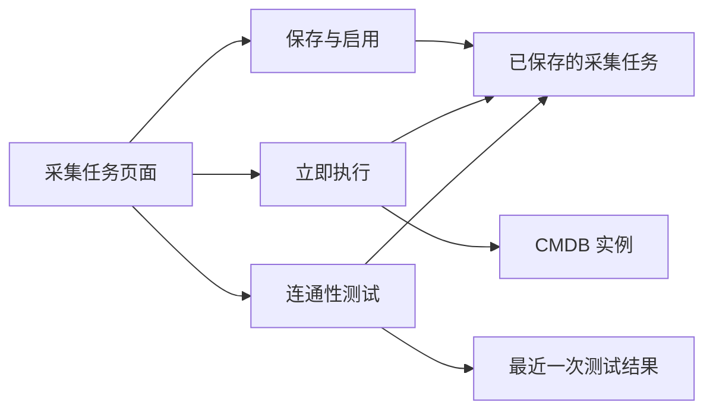
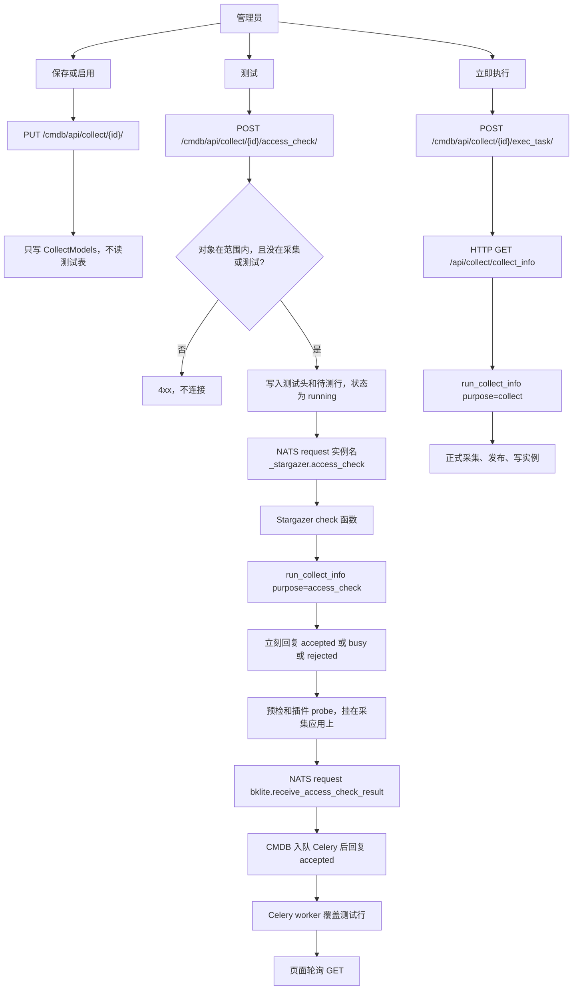
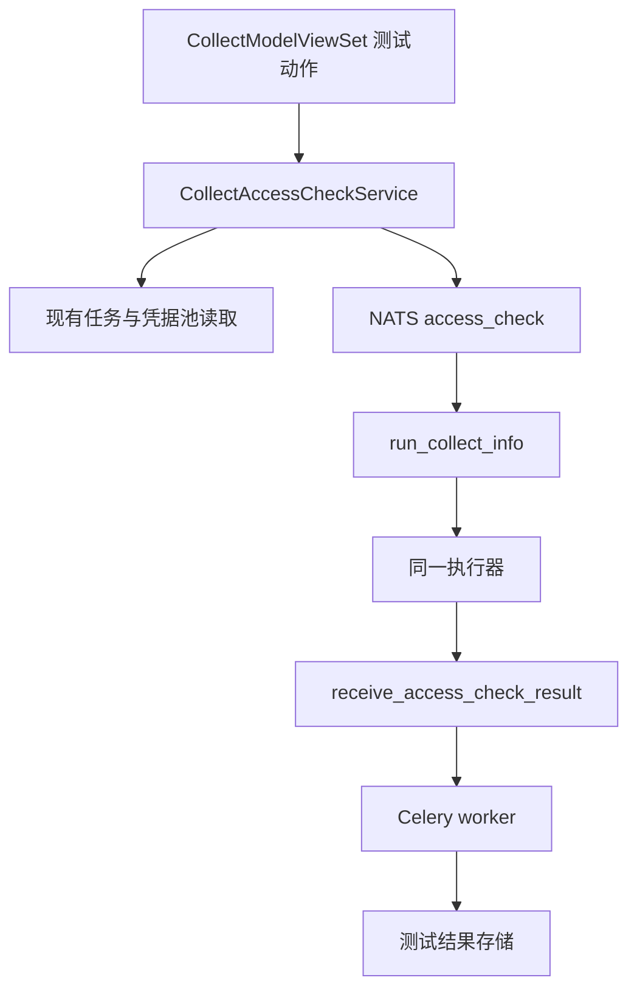

# 配置采集连通性测试

Status: 已实施

范围已按确认口径锁定。做：数据库类（协议）、云和虚拟化、API 类（华为存储、NetApp，以及云和虚拟化已有的 API 连通性函数）。不做：SNMP、IPMI、IP 发现、网络设备配置文件、自定义脚本、K8s。未点名的对象也不做。

术语沿用 `CONTEXT.md`：一行结果是一次凭据尝试的结论，不是新的采集任务，也不是一次采集运行。端口、协议和区域属于目标，不属于凭据。

---

## 1. 需求设计

### 1.1 要解决的问题

配置采集任务保存后，管理员只能「立即执行」。那一次会拉取完整配置并写入 CMDB。网络不通、密码错误、权限不够和协议不符混在同一次采集失败里，而且正式采集遇到第一条可用凭据就停止，其余凭据看不到。

管理员还需要先把任务建好、暂不启用。连通性失败不能挡住这次保存。

### 1.2 目标

对已保存的配置采集任务做一次连通性测试，判断它是否具备可执行条件。

- 每个目标，乘以对该目标生效的每条凭据，都有一行结论。
- 测试只调用该采集器已有的连通性函数，不拉取完整清单。
- 测试失败不影响保存、更新和启用。
- 测试不写 CMDB 实例，不改变采集状态、最近上报时间、凭据冷冻和凭据亲和。

### 1.3 本次采集对象

只给下面三类已保存任务提供「测试」。判定看对象树里的分类和驱动，不按任务名字猜测。

| 本次做 | 对象树上的位置 | 例子 |
|---|---|---|
| 数据库类（协议） | 「数据库」分类，驱动是协议，不是脚本 | MySQL、PostgreSQL、MSSQL、InfluxDB，以及同一分类下后续增加的协议数据库 |
| 云和虚拟化 | 「云平台」「虚拟化」 | 阿里云、腾讯云、华为云、FusionInsight、vCenter、Hyper-V |
| API 类 | 使用平台 API 账号的对象 | 华为存储、NetApp ONTAP；云平台和虚拟化也走各自已有的 API 连通性函数 |

脚本类数据库不在「数据库类（协议）」里。Redis、MongoDB、Elasticsearch、HBase 走脚本驱动，本次不做。

本次不做：

| 不做 | 原因 |
|---|---|
| SNMP | 已有测试通道，本按钮不重复做 |
| IPMI | 已有测试通道，本按钮不重复做 |
| IP 发现 | 本次不覆盖 |
| 网络设备配置文件 | 本次不覆盖 |
| 自定义脚本 | 本次不覆盖 |
| K8s | 本次不覆盖 |

未点名的对象也不做，包括主机、主机配置文件、中间件、脚本类数据库、Redfish、PC，以及未点名的存储 API（例如 Dell Unity）。这些任务不显示本按钮；若直接调用接口，拒绝并不连接。范围按对象判断，不按 `task_type=cloud` 或 `protocol` 整类放行。SNMP、IPMI 的现有测试通道保持原样。

### 1.4 谁在用、从哪进

CMDB 管理员在配置采集任务列表操作里点击「测试」，权限与「立即执行」相同（`auto_collection-Execute`）。只针对已经保存的任务。未保存表单不在本次范围。页面已有的 PC 未落库连接测试保持原样，不并入这条能力。

### 1.5 和保存、启用、立即执行的关系

三条动作互不驱动：

| 动作 | 是否要求测试通过 | 失败或未测试时 |
|---|---|---|
| 保存、更新 | 否 | 仍然成功。可以先创建并保持不启用 |
| 启用 | 否 | 不因测试失败而拒绝启用，也不因测试通过而自动启用 |
| 立即执行 | 否 | 仍按现在的正式采集执行 |

保存成功不自动发起测试。测试不是保存事务的一步。

同一任务上，测试与立即执行互斥：正在采集时不能开始测试；测试进行中不能再次测试，也不能立即执行。避免同一目标同时建两套连接。

### 1.6 结果怎么读

「凭据可用」只表示连通性函数通过，任务具备可执行条件。它不表示完整数据已经采到，也不表示正式采集一定能写全字段。

| 结论 | 含义 | 该目标其余凭据 |
|---|---|---|
| 网络不通 | 解析失败、连接超时、连接被拒绝、没有路由。不是 ping | 不再连接，记为凭据未测 |
| 凭据未测 | 该目标已确认网络不通或被限流，这条凭据没有发起连接 | 已跳过 |
| 凭据可用 | 连通性函数通过 | 继续 |
| 凭据不正确 | 对端明确拒绝身份 | 继续 |
| 权限不足 | 身份被接受，但权限不够 | 继续 |
| 无响应 | 仅当本次对象的连通性函数明确返回「无回包且没有认证错误」 | 继续 |
| 协议或证书不符 | 端口通了但不是预期协议，或证书校验失败 | 继续 |
| 服务不可用 | 连上之后服务声明不可用，且不是认证失败 | 继续 |
| 请求被限流 | 对端明确限流 | 不再连接，记为凭据未测 |
| 不能测 | 该采集器没有合格的连通性函数 | 继续；若此前端口已拨不通，整组仍是网络不通 |
| 探测异常 | 抛错或无法形成一次连接，且不能归入上表 | 继续 |
| 凭据未配置 | 该目标没有生效凭据 | 不连接 |

归类只使用连通性函数返回的稳定状态，不根据异常原文猜测。

### 1.7 组合规则

- 目标使用该任务正式采集会使用的目标列表。
- 没绑定目标的凭据，对每个目标都测。
- 绑定了目标的凭据，只出现在对应目标上。
- 冷冻中的凭据这次照样测，测试结果不写回冷冻，也不写凭据亲和。
- 没有凭据时不连接，每个目标一行「凭据未配置」。
- 一条凭据可用后，其余凭据继续测。正式采集才会在第一条可用凭据处停下来并开始采集。

### 1.8 页面上要看到什么

页面细节在第 7 节。这里只定用户能看到的事实：

- 范围内任务的操作列有「测试」。范围外任务没有这个按钮。
- 点开后是该任务最近一次测试的抽屉：进度，以及每一行的目标、凭据名称、结论、说明。
- 凭据未测的行保留。说明只用稳定短原因，不展示口令、密钥、异常正文和堆栈。
- 任务未启用时仍可测试。测试不改变启用开关，也不改变列表上的采集状态。
- 不提供从失败行发起正式采集，也不提供只重测一行。

### 1.9 明确不做

未保存表单试连、测试历史、导出、告警、定时测试、取消进行中的测试、为没有 `probe` 的采集器另写一套测试客户端、改变 `collect` 模式的采集和入库行为、对外 OpenAPI、用 ping 判断网络、业务监控采集插件的测试按钮。

IP 发现、配置文件采集、自定义脚本、SNMP、IPMI、主机、中间件、K8s、脚本类数据库、Redfish、PC 都不进入这条测试。不为 SNMP 和 IPMI 再做一套按钮，也不改它们已有的测试通道。

---

## 2. 需求架构设计

测试是采集任务旁边的一条独立检查，不是正式采集的一种模式，也不是保存流程的校验器。



保存只写任务。立即执行读任务、跑完整采集、写实例，并改采集状态。连通性测试读任务、写测试结果，不写实例，不改任务的启用和采集状态。

架构上分成四个边界：

| 边界 | 职责 | 不负责 |
|---|---|---|
| 页面 | 发起测试、看进度和结果表 | 组凭据、连目标、决定能否保存 |
| CMDB 服务 | 鉴权、确认对象属于第 1.3 节、读已保存任务、展开目标和凭据、收下结果、只留最近一次 | 自己实现云 API、存储 API 或数据库拨号 |
| Stargazer 采集运行 | 同一条预检和插件 `probe`。`access_check` 在探测后返回；`collect` 才继续正式采集并发布 | 页面协议、测试结果表、凭据冷冻的写入策略由模式决定 |
| 采集插件 | 只实现一次 `probe` 和 `collect`。阿里云、腾讯云、vCenter 的 `probe` 调用已有的 `get_connection_result` 或 `test_connection` | 再写一套只给测试用的客户端 |

测试和正式采集共用从 `collect_info` 抽出的一份函数：展开目标、解析凭据、构建请求、解析插件，再进入同一条执行器。`access_check` 在 `probe` 返回后结束；`collect` 才继续 `collect`、发布和写凭据状态。新增采集对象只维护插件里的这一对函数。

HTTP `GET /api/collect/collect_info` 和 Stargazer 的 NATS 函数 `access_check` 都调用这份函数。HTTP 适配器把模式固定为 `collect`。check 函数把模式固定为 `access_check`。请求里自带的模式不生效。check 函数不请求 HTTP 接口。

和 PC 未落库连接测试的分界：那条能力测的是尚未保存的 PC 表单，经 debug 端点直连。本次只测已保存的配置采集任务，不复用那条未落库入口。

---

## 3. 链路设计

保存、测试、立即执行从页面分开进入，后面不再汇合。浏览器只访问 CMDB。CMDB 再访问 Stargazer。Stargazer 不把结果写回数据库。



### 3.1 从点击到看表

1. 管理员在采集任务列表点击「测试」。页面只提交任务 id，不提交表单草稿，也不提交口令。
2. CMDB 校验 `auto_collection-Execute` 和该任务的对象权限。对象不在第 1.3 节，返回 400，不建测试记录，不连接。
3. 任务的 `exec_status` 正在采集或写入时，返回 409。该任务已有 `running` 的测试时，返回 200，带上同一次测试，不再发 NATS。检查额度已满时返回 429。超过「每个目标的任务超时 × 目标数 + 30 秒」仍为 `running` 的测试，先记为 `stargazer_timeout`，再按没有进行中的测试处理。还没返回的行记为 `no_response`，说明是测试超时，不写成探测异常。这几步都不改 `enabled` 和 `exec_status`。
4. 通过后，CMDB 用已保存的 `CollectModels` 展开目标，并用已保存凭据池展开对该目标生效的凭据。凭据在服务端解密后只放进发往 Stargazer 的 NATS 消息，不写入测试表，也不进入 Celery 参数。
5. CMDB 删掉该任务上一条测试，写入新的测试头，状态为 `running`，并按组合预先写入 `pending` 行。然后同步发起 NATS request，只等接纳，超时 10 秒。不使用本进程后台线程。
6. NATS 服务名是 `{实例名}_stargazer`。任务接入点能解析出云区域名时，实例名用该云区域名，与 `list_regions` 相同。解析不出时用环境变量 `STARGAZER_NATS_INSTANCE_ID`，它必须与实际处理 `collect_info` 的 Stargazer 的 `NATS_INSTANCE_ID` 相同，缺省 `default`。方法名是 `access_check`。消息体是现有采集参数，加上 `collect_task_id` 和 `check_id`。
7. Stargazer 的 `access_check` 使用队列组。它调用抽离后的 `run_collect_info`，模式固定为 `access_check`。reply 只有 `accepted`、`busy` 或 `rejected`，没有结果行。`accepted` 之后，探测任务登记在 `CollectionApplication` 上，进程关闭时与其他采集共用现有 grace。它不进入 `submit()` 的 Redis 租约，也不占用正式采集名额。
8. `POST` 只有收到 `accepted` 才返回 202。页面只提示已发起，不打开结果。连不上、超时、`busy`、`rejected` 时，把这次改为 `failed`，不保持 `running`，并返回对应的 503 或 429。接纳回复丢失时按失败返回；之后到达的回程因为状态已不是 `running` 而被丢弃。
9. 执行器对每个目标先做现有 IP 预检，再对每条凭据调用该插件的 `probe()`。模式为 `access_check` 时不调用 `collect`，不发布采集结果，不写凭据冷冻和亲和。Stargazer 不写 CMDB 数据库。
10. 按「目标 × 生效凭据」的行数决定是否分批。不足 50 行只在结束时送回一次。达到 50 行后，把总数切成大约 8 批，每批不少于 20 行、不超过 50 行，用 NATS request 送到 `bklite.receive_access_check_result`，`status=running`。最后不足一批的用 `status=finished` 送回。信封与配置文件回传相同。收到 `{accepted: true, check_id}` 后不再重发这一批；没有成功回复时按正式采集的发布重试次数再试，失败的这一批留到下一次发送。进程内异常的 `error_code` 为 `stargazer_unavailable`，不含异常正文。
11. CMDB 的 NATS 函数不做落库。它确认 `check_id` 和 `collect_task_id` 后把安全字段投入 Celery，入队成功才回复 `accepted`。入队失败不回复成功，留给 Stargazer 重试。
12. Celery worker 按 `check_id` 更新对应行，不删除还没回来的行。`running` 批次只更新这一批，测试头保持 `running`。`finished` 批次更新最后一批；仍有未回行时测试保持 `running`，等较早的批次入库后再写成 `finished`。失败时写成 `failed`。重复批次覆盖同一行。worker 自己失败时记 `result_persist_failed`。Celery 在回复之后不可用时，测试停在 `running`，直到第 3 步的超时把它记为 `stargazer_timeout`。这个超时不取消 Stargazer 上已经在进行的连接。
13. 抽屉打开且状态为 `running` 时，页面每 2 秒 GET。Celery 写完之前进度保持 `0 / total_count`。状态不再是 `running` 后停止轮询。
14. 管理员离开列表再回来，页面再次 GET 同一次记录。没有「重新开始」按钮。下次点击「测试」才替换这一次。

正式采集仍走原来的 `exec_task` 和 HTTP `GET /api/collect/collect_info`。该 HTTP 适配器调用同一份 `run_collect_info`，模式固定为 `collect`，随后进入现有 `submit()`、调度和采集结果发布。它不读测试表。测试也不写 `CollectTaskCredentialHit`。

### 3.2 同一条链路，用模式停下

对象已经在 CMDB 被判定为范围内。SNMP、IPMI、IP 发现、配置文件、自定义脚本不会进入执行器。

正式采集今天的顺序不变：`TargetAttemptRunner` 先做 IP 预检，预检失败就不再试凭据；预检通过后，`CredentialAttemptRunner` 对凭据调用插件 `probe()`。`probe` 会真正连到插件里，例如 MySQL 登录、阿里云取地域。`probe` 返回可以继续后，正式采集才 `collect` 并发布。

测试不复制这段代码。请求上的模式为 `access_check` 时，执行器在同一位置改四个行为：

| 位置 | `collect` | `access_check` |
|---|---|---|
| IP 预检失败 | 该目标结束，不试凭据 | 同样不试凭据。结果表里该目标每一行都是网络不通，凭据未测 |
| 插件没有 `probe` | 用正式 `collect` 充当凭据尝试 | 不调用 `collect`。每一行是不能测 |
| `probe` 返回可以继续 | 立刻 `collect`，并停止其余凭据 | 记为凭据可用，不 `collect`，继续其余凭据 |
| 认证失败 | 写凭据冷冻，再试下一条 | 记为凭据不正确，不写冷冻，再试下一条 |
| 凭据选择 | 跳过冷冻中的凭据，成功过的优先 | 忽略冷冻和亲和，绑定了其他目标的凭据仍然不测 |

预检、拨端口、进入哪个插件，仍是原来的实现。云账号没有共享端口时，现有预检本来就不会先拨端口，测试同样直接进入 `probe`。

一条凭据在 `probe` 中的归类：

- 共享端口上的传输失败：该行 `network_unreachable`，同目标未测凭据 `not_tested`，停止这个目标。
- 明确拒绝身份：`credential_rejected`，继续。说明用稳定字段码：`credential_user`、`credential_password`、`credential_user_or_password`、`credential_database`、`credential_token`。只写字段名，不写字段值。驱动分不出用户名和密码时用 `credential_user_or_password`。
- 身份接受但权限不够：`permission_denied`，继续。
- `probe` 通过：`credential_ok`，继续。通过不表示完整数据已采到。
- 协议不符或证书失败：`protocol_or_tls`，继续。
- 明确限流：该行 `rate_limited`，其余 `not_tested`，停止这个目标。
- 没有 `probe`：`unsupported`，继续，且不降级成 `collect`。
- 传输失败的说明用连接原因：`tcp_connection_refused`、`tcp_connect_timeout`、`dns_resolution_failed`、`tcp_no_route`、`tcp_connect_failed`。Stargazer 只把这个稳定码写入日志。
- 插件抛出的其他代码异常：该行 `system_error`。异常类型和正文只写在 Stargazer 日志，不进入回程、Celery 参数或结果行。
- 其余已识别的失败：`service_unavailable` 或 `probe_error`，继续。

预检组件自己出错时，不把整组写成网络不通，改为继续对该目标的凭据调用 `probe`。没有生效凭据时不连接，一行 `no_credential`。

### 3.3 插件只写一次 `probe`

| 对象 | `probe` 怎么接已有函数 | 通过标准 | 不做什么 |
|---|---|---|---|
| 协议数据库 | 该库已有的 `probe` | 能登录，并完成一次最小读取，例如读取版本 | 不拉库、表、复制状态等完整配置 |
| 阿里云 | `probe` 调用已有 `get_connection_result` | 能取回地域 | 不拉主机、磁盘、规格 |
| 腾讯云、华为云及同类云账号 | `probe` 调用已有 `test_connection` 或取地域函数 | 能取回地域 | 不拉实例清单 |
| vCenter | `probe` 调用已有 `test_connection` | 会话能建立并断开 | 不枚举虚拟机和宿主机 |
| Hyper-V | `probe` 做一次 WinRM 登录 | 能完成登录级探测 | 不拉虚拟机清单 |
| 华为存储、NetApp | `probe` 做一次管理 API 登录。华为存储 HTTP 401 是凭据不正确，403 是权限不足 | 管理 API 能登录 | 不拉存储池、磁盘、卷和端口 |
| 范围内但没有 `probe`，或 `probe` 会拉完整清单 | 不调用 `collect` | 不能测 | 不另写测试专用客户端 |

---

## 4. 后端代码架构设计

### 4.1 同一执行器，用模式分开测试和正式采集

正式采集的入口保持不变：

`CollectModelViewSet.exec_task` → `CollectModelService.exec_task` 把 `exec_status` 写成执行中 → 下发采集 → Stargazer HTTP `GET /collect/collect_info` → `run_collect_info(purpose=collect)` → `CollectionApplication.submit` → `TargetCollectionExecutor`。

测试的入口是另一条传输，背后是同一份函数：

`POST /access_check/` → NATS `{实例名}_stargazer.access_check` → `run_collect_info(purpose=access_check)` → 同一执行器的 `execute_access_check`。探测结束后 NATS request `bklite.receive_access_check_result` → CMDB 入队 Celery → worker 写测试表。

`submit()` 的 Redis 租约只属于正式采集。测试不进入这把锁，避免和正式采集互相判成正在执行。

模式行为仍放在现有 `TargetAttemptRunner` 和 `CredentialAttemptRunner`：

- 模式只有适配器能设置。HTTP 固定 `collect`，check 函数固定 `access_check`。
- `access_check` 使用同一预检、同一 `probe`、同一凭据循环。
- `access_check` 在 `probe` 之后形成该凭据的结论，不调用 `collect`，不经过采集 `ResultPublisher`。
- `access_check` 不调用凭据策略的成功和失败写入。冷冻中的凭据这次仍参与测试。
- 插件没有 `probe` 时，`collect` 仍按今天的方式用正式采集判断凭据；`access_check` 记为不能测。
- `collect` 模式的停止、发布、冷冻和亲和保持现有行为。

### 4.2 模块



| 模块 | 放置 | 做什么 |
|---|---|---|
| 测试动作 | `CollectModelViewSet` 上与 `exec_task` 并列的新动作，权限同为 `auto_collection-Execute` | 发起测试、查询最近一次结果。不放进 `create` / `update` |
| `CollectAccessCheckService` | CMDB 服务层新服务 | 先按第 1.3 节拒绝范围外对象，再校验互斥，读已保存任务，调用检查客户端，落最近一次结果。不改 `exec_status`、启用状态和实例 |
| 任务与凭据池读取 | 复用现有 `NodeParams` / 凭据池解析 | 目标和凭据与正式采集使用同一份已保存配置。忽略冷冻，保留凭据上的目标绑定 |
| 检查客户端 | `StargazerCollectTriggerClient` 上的接纳方法 | NATS request `access_check`，只取接纳结果。不从响应体取测试行 |
| 回程 | CMDB NATS 函数 `receive_access_check_result` 和 Celery 任务 | NATS 函数校验身份并入队，回复 `accepted`。worker 落库 |
| 测试结果存储 | 按任务只保留一条最近结果，独立于 `CollectModels.exec_status` 和 `collect_data` | 进行中进度、结束后的结果行。保存任务时不读写它 |
| `run_collect_info` | 从 `collect_info` 抽出的函数 | HTTP 和 check NATS 函数都调用它。只有 `collect` 进入 `submit()` |
| 执行器模式 | 现有 `TargetCollectionExecutor` 接受 `collect` 或 `access_check` | `access_check` 不进入采集结果发布，也不占用正式采集接纳。预检和 `probe` 的超时与正式采集相同 |
| 凭据尝试 | 现有 `CredentialAttemptRunner` | 按第 3.2 节的模式表决定是否 `collect`、是否写冷冻、是否继续其余凭据 |
| 采集插件 | 已有 `probe`；没有 `probe` 的范围内对象，把现有 `test_connection` 或 `get_connection_result` 接到 `probe` | 不新增第二套客户端。`probe` 会拉完整清单的，测试模式记为不能测 |

范围外对象在 CMDB 服务层就被拒绝，不会进入执行器。`collect` 模式没有测试表，也不会因为这次改动而在探测通过后停下来。

### 4.3 结果行

一行只含：目标、凭据标识与名称、结论、稳定说明、是否实际发起了凭据连接。

不含口令、community、密钥、请求体、响应体和异常原文。操作日志只记操作人、任务和结束时的汇总计数。

### 4.4 接纳

测试不进入 `submit()` 的采集接纳，所以配置采集满载时测试仍可开始。测试另有自己的并发额度，额度满时 Stargazer 回复 `busy`，CMDB 把这次记为 `failed` 并返回 429。预检和 `probe` 的超时沿用该插件正式采集的预检超时和探测超时。接纳请求本身只等 10 秒。

回程是 NATS request，不是把行放进接纳 reply。探测可以跑到任务超时，长于 NATS 请求的默认等待。CMDB 先把落库任务投入 Celery，再回复；worker 才写行。

### 4.5 测试要锁住的行为

- 保存、更新、启用不读取测试结果；测试失败时三者仍然成功，启用状态不变。
- 测试不修改 `exec_status` 和最近上报时间，也不写实例。
- IP 发现、配置文件、自定义脚本、SNMP、IPMI、主机、中间件、K8s、脚本类数据库、Redfish、PC 被拒绝，且没有连接。SNMP 与 IPMI 的原测试通道仍可单独使用。
- 协议数据库端口拨不通时，该目标全部凭据行是网络不通加凭据未测，且没有调用 `probe`。登录出现传输失败时，该行是网络不通，其余行是凭据未测。认证失败继续测其他凭据。
- `collect` 模式在 `probe` 通过后仍正式采集并发布，认证失败仍写冷冻。`access_check` 模式不调用 `collect`、不发布、不写冷冻和亲和，并且一条凭据可用后继续测其余凭据。
- 权限不足不是凭据不正确。
- 阿里云只请求地域，不请求主机清单。一条云凭据传输失败不跳过其他云凭据。
- 华为存储、NetApp 只做到管理 API 登录，不拉存储池、磁盘和卷。vCenter 只建立并断开会话。
- 范围内没有合格连通性函数时结论是不能测。
- 绑定到其他目标的凭据不会用来连接当前目标。冷冻中的凭据仍被测试。
- 结果和日志中不出现口令、密钥和云访问密钥。
- 采集进行中拒绝测试；测试进行中拒绝第二次测试和立即执行。
- `POST /cmdb/api/collect/{id}/access_check/` 不接收目标、凭据和口令。响应和测试行里不出现这些秘密。
- 保存、启用和列表接口不读写 `cmdb_collect_access_check`。删除任务时测试头和行一起删除。新一次测试替换上一次，不保留两份。

## 5. 数据库设计

只存最近一次，不按 IP 合成一条大记录。

这个按钮回答的是任务现在能不能执行，抽屉也只展示这一次。谁在什么时候测过、结束时的汇总，记在操作日志里。每次测试的逐行历史不入库；新的一次跑完后不能再翻看上一次的每一行。

存储分成两层：

- 一个任务一条测试头，`task_id` 唯一。新测试开始时删掉该任务的旧头和旧行，再写入新的。
- 每个「目标 + 凭据」一行。同一个 IP 有几条生效凭据就有几行。没有凭据的目标也留一行。端口拨不通时，未连接的凭据行仍然保留，结论是凭据未测，不把这些行删掉。

例如两个 IP、两条都未绑定目标的凭据，这一次是 1 条头、4 行：

| 目标 | 凭据 | 结论 | 是否真正连过 |
|---|---|---|---|
| 10.0.0.8 | 凭据 1 | 网络不通 | 否 |
| 10.0.0.8 | 凭据 2 | 凭据未测 | 否 |
| 10.0.0.9 | 凭据 1 | 凭据不正确 | 是 |
| 10.0.0.9 | 凭据 2 | 凭据可用 | 是 |

测试结果不写入 `CollectModels`。不改 `exec_status`、`exec_time`、`enabled`、`collect_data`、`collect_digest`。也不写入 `CollectTaskCredentialHit`。保存和启用只读写采集任务，不读写下面两张表。删除采集任务时，两张表随外键级联删除。

新增迁移依赖当时 CMDB 的叶子迁移，不复用已有编号。

### 5.1 `cmdb_collect_access_check`

一次测试的头。`task_id` 唯一。

| 列 | 类型 | 约束 | 含义 |
|---|---|---|---|
| id | bigint | 主键 | |
| task_id | bigint | 外键 `cmdb_collectmodels.id`，级联删除，唯一 | 所属已保存任务 |
| status | varchar(16) | 非空 | `running`、`finished`、`failed` |
| total_count | integer | 非空，默认 0 | 展开后的组合数，含未真正连接的行 |
| finished_count | integer | 非空，默认 0 | 结论已不再是 `pending` 的行数 |
| started_at | timestamptz | 非空 | 本次开始 |
| finished_at | timestamptz | 可空 | `finished` 或 `failed` 时写入 |
| operator | varchar(150) | 非空，默认空串 | 发起人，只用于审计展示 |
| error_code | varchar(64) | 非空，默认空串 | 整次失败的稳定码，如 `stargazer_timeout`。成功时为空 |

### 5.2 `cmdb_collect_access_check_row`

一个目标上的一条凭据一行。没有凭据的目标也有一行。

| 列 | 类型 | 约束 | 含义 |
|---|---|---|---|
| id | bigint | 主键 | |
| check_id | bigint | 外键测试头，级联删除，索引 | 所属这一次测试 |
| position | integer | 非空，从 0 开始 | 展示顺序 |
| target | varchar(255) | 非空 | 目标。IP、域名、Endpoint 或云账号标识 |
| credential_id | varchar(64) | 非空，默认空串 | 凭据标识。无凭据时为空串 |
| credential_name | varchar(255) | 非空，默认空串 | 页面展示名。没有单独名称时用序号，如「凭据 1」 |
| conclusion | varchar(32) | 非空 | 见下表 |
| detail_code | varchar(64) | 非空，默认空串 | 稳定短原因，如 `tcp_connection_refused`、`credential_password`、`system_error` |
| attempted | boolean | 非空，默认 false | 是否真正发起了凭据连接。拨端口失败或被跳过时为 false |

约束：`(check_id, target, credential_id)` 唯一。同一凭据不会在同一目标上出现两行。

`conclusion` 只允许这些值：

| 值 | 页面文案 |
|---|---|
| `pending` | 测试中 |
| `network_unreachable` | 网络不通 |
| `not_tested` | 凭据未测 |
| `credential_ok` | 凭据可用 |
| `credential_rejected` | 凭据不正确 |
| `permission_denied` | 权限不足 |
| `no_response` | 无响应 |
| `protocol_or_tls` | 协议或证书不符 |
| `service_unavailable` | 服务不可用 |
| `rate_limited` | 请求被限流 |
| `unsupported` | 不能测 |
| `probe_error` | 探测异常 |
| `system_error` | 系统错误 |
| `no_credential` | 凭据未配置 |

行里不保存口令、community、密钥、请求体、响应体、异常原文和地域清单。`credential_name` 来自任务里已有的凭据显示名；任务没有显示名时只保存序号。

## 6. 页面与后端交互

浏览器只调用 CMDB。权限与 `exec_task` 相同：`auto_collection-Execute`，并校验这条任务的对象权限。

### 6.1 发起测试

`POST /cmdb/api/collect/{id}/access_check/`

请求体为空。页面不上传目标、凭据或口令。

| 条件 | HTTP | 响应 |
|---|---|---|
| 无权限 | 403 | 现有权限错误 |
| 对象不在第 1.3 节 | 400 | `error_code=out_of_scope` |
| 正在采集或写入 | 409 | `error_code=collect_running` |
| 已有进行中的测试 | 200 | 返回那一次的头和当前行，不新建 |
| 检查额度已满 | 429 | `error_code=check_busy` |
| 可以开始且 Stargazer 已接纳 | 202 | 新建的头，行的结论都是 `pending` |
| Stargazer 回复繁忙 | 429 | `error_code=check_busy`，这次测试头为 `failed` |
| 接纳超时 | 503 | `error_code=stargazer_timeout`，这次测试头为 `failed` |
| 接纳被拒绝或 Stargazer 不可用 | 503 | `error_code=stargazer_unavailable`，这次测试头为 `failed` |

202 和 200 的响应体：

```json
{
  "id": 18,
  "task_id": 42,
  "status": "running",
  "total_count": 4,
  "finished_count": 0,
  "started_at": "2026-11-18T02:00:00Z",
  "finished_at": null,
  "error_code": "",
  "rows": [
    {
      "target": "10.0.0.8",
      "credential_id": "credential-1",
      "credential_name": "凭据 1",
      "conclusion": "pending",
      "detail_code": "",
      "attempted": false
    }
  ]
}
```

### 6.2 读取最近一次

`GET /cmdb/api/collect/{id}/access_check/`

从未测试过返回 404，`error_code=not_tested`。有记录时返回 200，结构与上面相同。`status` 为 `finished` 或 `failed` 时 `finished_at` 有值。

页面只在抽屉打开且 `status=running` 时每 2 秒调用一次。关闭抽屉即停止。再次打开先 GET 一次，若仍是 `running` 再继续轮询。

### 6.3 与保存、启用、立即执行的接口边界

| 接口 | 是否读写测试表 | 页面后果 |
|---|---|---|
| `POST /cmdb/api/collect/`、`PUT /cmdb/api/collect/{id}/` | 否 | 保存成功后列表不自动打开测试抽屉 |
| `POST /cmdb/api/collect/{id}/set_enabled/` | 否 | 启用开关不看测试结论 |
| `POST /cmdb/api/collect/{id}/exec_task/` | 否 | 测试 `running` 时 CMDB 返回 409，`error_code=check_running` |
| 列表 `GET /cmdb/api/collect/` | 否 | 列表不返回测试行。抽屉单独 GET |

测试进行中，列表上的采集状态保持原值。抽屉里的「测试中」只来自测试头的 `status`。

## 7. 前端设计

改动落在现有配置采集任务列表，不新开路由，不把结果放进任务编辑抽屉。

### 7.1 列表操作

操作列在「立即执行」旁增加「测试」文字按钮，样式与现有链接按钮一致。「测试」只发起测试，不打开结果。

- 对象不在第 1.3 节：不渲染按钮。
- 无 Execute 权限：不渲染按钮。
- 任务未启用：按钮仍可点。未启用只禁用「立即执行」。
- 正在采集、正在写入，或这次测试为 `running`：按钮禁用。测试进行中时按钮显示加载。
- 点击后按第 6.1 节发起请求。成功只提示已发起。4xx 用现有消息提示。

「采集开关」和「操作」之间增加「测试情况」列。范围内任务显示「查看」，点击后只 GET 最近一次结果并打开抽屉，不发起新的测试。范围外显示「--」。尚未测试时抽屉显示「尚未测试」，不弹出错误提示。

### 7.2 结果抽屉

使用 Ant Design Drawer，从右侧打开，宽度容纳四列表格。标题为「连通性测试」加任务名称。

抽屉内容从上到下：

1. 汇总行。显示最近一次测试时间（已结束用 `finished_at`，进行中用 `started_at`）、成功数量和失败数量。成功只计 `credential_ok`。`pending` 和 `not_tested` 不计入失败，其余结论计入失败。`running` 同时显示「测试中」和 `finished_count / total_count`。每批结果入库后进度、汇总和已完成的行立即可见。全部行回来后才变成 `finished`。不显示 Stargazer 原文。
2. 结果表。列是目标、凭据、结论、说明。说明由 `detail_code` 映射为固定中文，例如「连接被拒绝」「密码不正确」「系统错误」。没有 `detail_code` 时说明为空。异常原文不出现在说明里。
3. 底部只有「关闭」。没有「立即执行」，没有「只重测此行」，没有导出。

从未测试过时，抽屉显示「尚未测试」和「关闭」。不自动发起测试。

结论用现有 Tag 展示。颜色只用已有语义 token：`credential_ok` 用成功色，`network_unreachable`、`credential_rejected`、`permission_denied`、`failed` 用危险色，`pending` 和 `not_tested` 用中性色，其余用警告色。不新写一套色值。

表格行数就是 `rows.length`。`not_tested` 和 `no_credential` 不隐藏。

### 7.3 轮询和离开

抽屉打开且状态为 `running` 时每 2 秒 GET 一次。关闭抽屉、离开列表或状态变为 `finished` / `failed` 时停止。组件卸载时清除定时器。

再次进入列表不会自动打开抽屉。用户再点「测试」时，若上次仍是 `running`，服务端返回同一次结果，不另开一轮，页面仍不打开抽屉。点「测试情况」才 GET 并打开抽屉；若当时仍是 `running`，继续轮询。列表接口不带测试行，刷新后按钮要再次点击才知道这次测试还在进行。

## 8. 实施与验证

传输按第 3 节：CMDB 用 NATS 调用 Stargazer 的 `access_check`，该函数调用抽离后的 `run_collect_info`。结果经 `receive_access_check_result` 回到 CMDB，NATS 函数入队 Celery，worker 落库。HTTP `POST /api/collect/access_check` 不存在。

插件链路仍是：先预检，再调用 `probe()`，不调用 `collect()`，不发布采集结果，不写实例、启用状态、采集状态、凭据冷冻和凭据亲和。

验证：

- Stargazer：`cd agents/stargazer && uv run pytest tests/test_access_check_transport.py tests/test_access_check_mode.py tests/test_access_check_plugins.py tests/test_collection_http_admission.py tests/test_control_transport.py -q`，49 passed。HTTP `collect_info` 不能把模式改成测试；check 函数只回复接纳；回程请求会重试到 CMDB 回复 accepted。
- CMDB：`cd server && DB_ENGINE=sqlite DB_NAME=:memory: SECRET_KEY=cursor-cloud-dev ENABLE_CELERY=true uv run pytest apps/cmdb/tests/test_collect_access_check.py --no-cov -q`，17 passed。接纳失败不保持 running；回程入队时丢掉口令；worker 把行写成结论并且重复消息不再改写。
- MySQL 任务 50，目标 `127.0.0.1`：`POST` 返回 202，轮询期间为 running，随后 `finished`。一行结论是 `credential_rejected` / `authentication_failed`，`attempted=true`。任务采集状态仍是未执行。Stargazer 加载了 `plugins/inputs/mysql/plugin.yml`。第一次回程请求超时后按重试再发，CMDB 入队 Celery，worker 落库。
